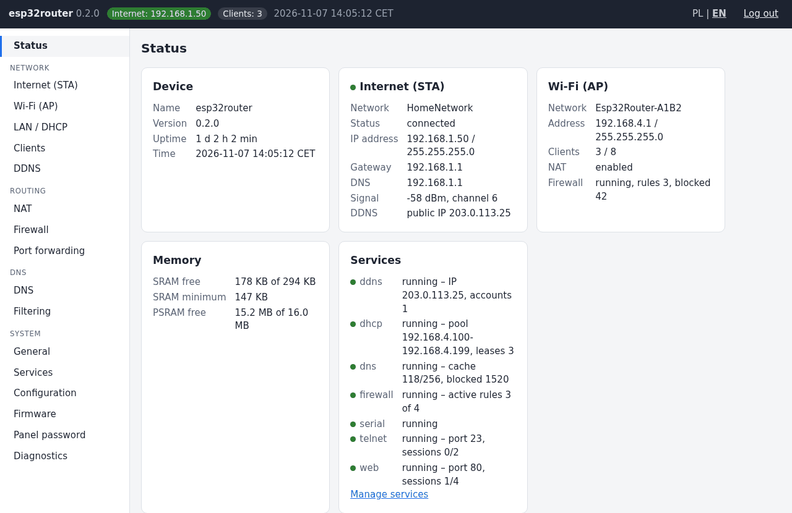
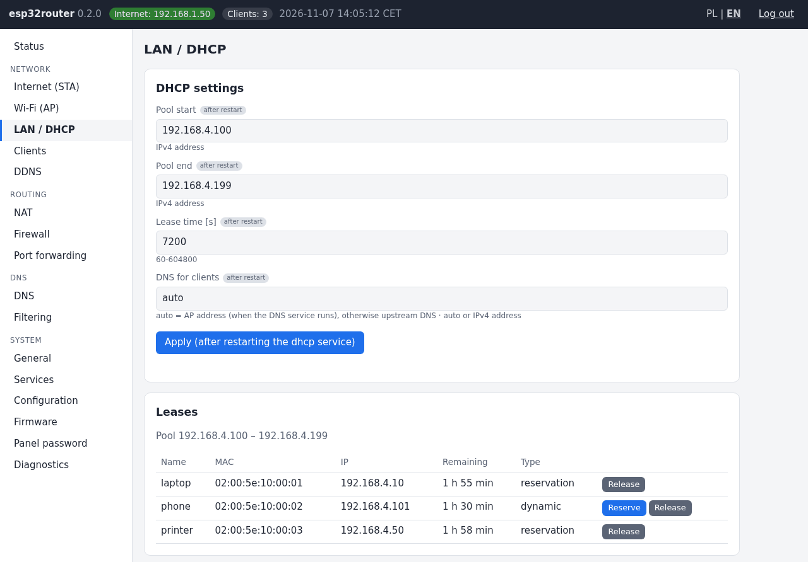
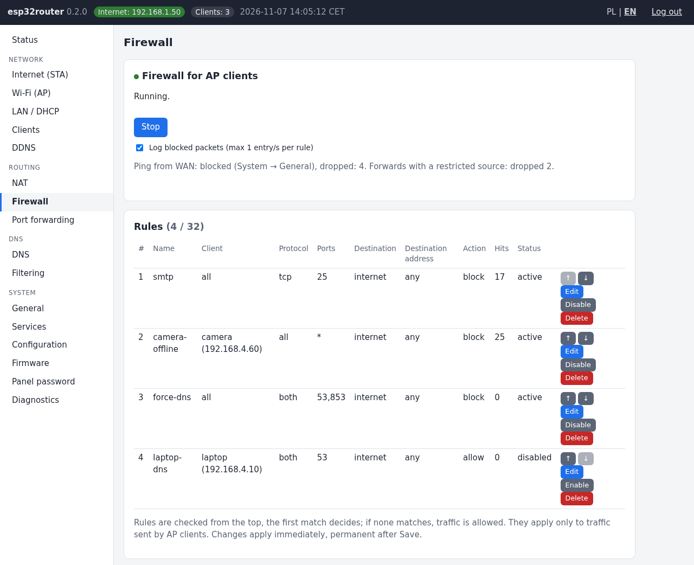
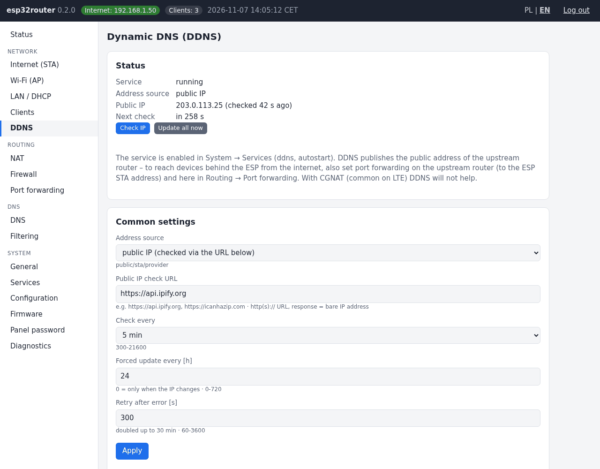
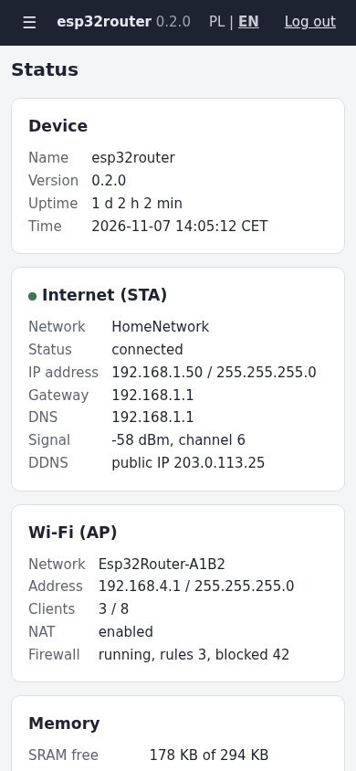

# Esp32Router

[English](#english) | [Polski](#polski)

## English

A small Wi-Fi router with NAT on the ESP32-S3: it connects to an existing network with internet access (STA) and runs its own network (AP) for its clients – with DHCP, DNS, domain filtering, port forwarding, a firewall, DDNS, a web panel, a COM/Telnet console and OTA updates. Panel and console in English or Polish.

- Version: **0.2.0**
- Chip: ESP32-S3 N8R16 (8 MB flash, octal PSRAM), PlatformIO + pioarduino, ESP-IDF 5.5, C++

### Documentation

**[doc/README.md](doc/README.md#english)** – description, features, first start and the list of documents:
[web panel](doc/panel.md#english) · [console](doc/console.md#english) · [configuration](doc/configuration.md#english) · [troubleshooting](doc/troubleshooting.md#english) · [source code and build](doc/source.md#english) · [design documents (Polish)](doc/dev/)

### Quick start

```bash
cp include/Secrets.h.example include/Secrets.h   # AP name and password, panel password
pio run -t upload
```

Connect to the `Esp32Router-XXXX` network and open <http://192.168.4.1>.

### Screenshots

Web panel in English (sample data; generated by `tools/screenshots.py`).

| Login | Status |
|---|---|
|  |  |
| **LAN / DHCP** | **Firewall** |
|  |  |
| **Dynamic DNS** | **Phone** |
|  |  |

---

## Polski

Mały router Wi-Fi z NAT na ESP32-S3: łączy się z istniejącą siecią z internetem (STA) i wystawia własną sieć (AP) dla swoich klientów – z DHCP, DNS, filtrowaniem domen, przekierowaniem portów, firewallem, DDNS, panelem WWW, konsolą COM/Telnet i aktualizacją OTA. Panel i konsola po polsku albo po angielsku.

- Wersja: **0.2.0**
- Układ: ESP32-S3 N8R16 (8 MB flash, PSRAM octal), PlatformIO + pioarduino, ESP-IDF 5.5, C++

### Dokumentacja

**[doc/README.md](doc/README.md#polski)** – opis, funkcje, pierwsze uruchomienie i spis dokumentacji:
[panel WWW](doc/panel.md#polski) · [konsola](doc/console.md#polski) · [konfiguracja](doc/configuration.md#polski) · [problemy](doc/troubleshooting.md#polski) · [kod i kompilacja](doc/source.md#polski) · [dokumenty projektowe](doc/dev/)

### Szybki start

```bash
cp include/Secrets.h.example include/Secrets.h   # nazwa i hasło AP, hasło panelu
pio run -t upload
```

Połącz się z siecią `Esp32Router-XXXX` i otwórz <http://192.168.4.1>.

### Zrzuty ekranu

Panel WWW w wersji angielskiej (przykładowe dane) – zrzuty w części [English](#screenshots), pliki w `doc/img/` (`tools/screenshots.py`).
