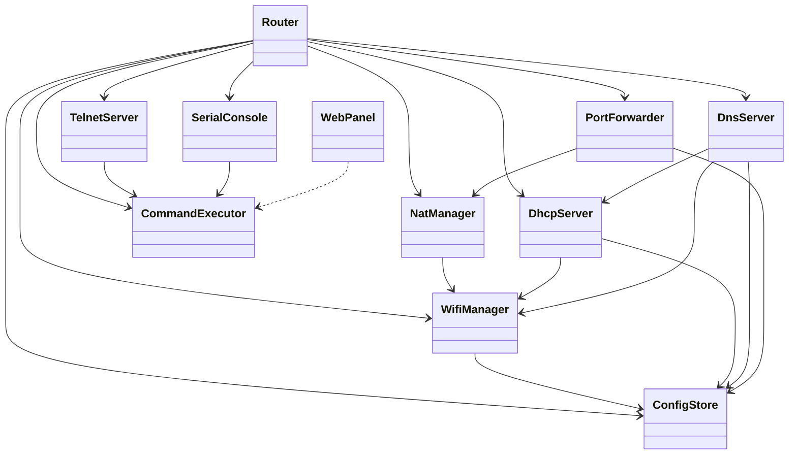

# Esp32Router – dokument projektu

> Status: **szkic do dyskusji**. Elementy oznaczone **[PROPOZYCJA]** wymagają akceptacji, a **[OTWARTE]** nie są jeszcze ustalone.

## 1. Cel

ESP32-S3 pracuje jako mały router Wi-Fi. Łączy się jako klient (STA) z istniejącą siecią z internetem i jednocześnie wystawia własny punkt dostępowy (AP). Udostępnia internet klientom AP przez NAT, rozdaje im adresy (DHCP), rozwiązuje nazwy (DNS) i pozwala na przekierowanie portów. Zarządzanie odbywa się przez Telnet, port szeregowy (COM) i w przyszłości panel WWW.

## 2. Platforma

| Element | Wybór |
|---|---|
| Układ | ESP32-S3 N8R16 (płytka esp32-s3-devkitc-1): 8 MB flash (quad, QIO), PSRAM octal |
| Platforma | pioarduino (`platform-espressif32`, wydanie stable) |
| Framework | ESP-IDF (czysty, bez Arduino) |
| Język | C++ (każda funkcjonalność w osobnej klasie), `app_main` jako `extern "C"` w `main.cpp` |
| Stos sieciowy | lwIP z włączonym `IP_FORWARD` i `IPV4_NAPT` (już w `sdkconfig.defaults`) |
| Pamięć konfiguracji | Pliki JSON na LittleFS (komponent `joltwallet/littlefs`), parsowanie przez cJSON z ESP-IDF; NVS tylko dla sterownika Wi-Fi |
| Partycje | `partitions.csv` (8 MB, OTA): `nvs` 24 KB @0x9000, `phy_init` @0xF000, `ota_0` 3 MB @0x10000, `littlefs` 1 MB @0x310000 (konfiguracja – bez zmian względem wcześniejszego układu), `ota_1` 3 MB @0x410000, `otadata` 8 KB @0x710000 (na końcu, nie musi stać przed aplikacjami), ok. 950 KB wolne. Rollback OTA włączony (`CONFIG_BOOTLOADER_APP_ROLLBACK_ENABLE`): nowy firmware potwierdza poprawny start po uruchomieniu Wi-Fi i usług, inaczej bootloader wraca do poprzedniego. Wgranie przez USB zapisuje też `ota_data_initial.bin` (start z `ota_0`). |
| Budowanie i wgrywanie | `pio run` / `pio run -t upload` – środowisko główne `esp32-s3-devkitc-1` (domyślne, USB). **OTA z PlatformIO**: `pio run -e esp32-s3-ota -t upload [--upload-port <IP>[:port]]` – środowisko `esp32-s3-ota` (`extends` głównego, ta sama konfiguracja, osobny katalog budowania i `sdkconfig.esp32-s3-ota`), `upload_protocol = custom`, domyślnie `192.168.4.1`. Skrypt `tools/ota_upload.py` (biblioteka standardowa Pythona, można też wołać ręcznie): logowanie do panelu, wysłanie `firmware.bin` na `POST /api/ota` z postępem co 10%, czytelne błędy (złe hasło, blokada po 5 próbach, odrzucony obraz, brak połączenia), po restarcie sprawdzenie wersji (`/api/session`, do 60 s; inna wersja = rollback). Hasło panelu: zmienna `ESP32ROUTER_WEB_PASS`, potem `SECRET_WEB_PASS` z `include/Secrets.h` (hasło fabryczne – nie działa po zmianie hasła w panelu), na końcu pytanie w terminalu; nigdy w `platformio.ini`. Wymaga dostępu do panelu: komputer w sieci AP albo `mgmt_from_sta = true`. |
| Panel WWW | `esp_http_server`, tylko HTTP. Pliki w katalogu `web/` (HTML/CSS/JS do edycji), przy każdej kompilacji pakowane gzipem przez `tools/web_embed.py` do `src/generated/WebAssets.cpp` (generowany, poza gitem) i wkompilowane w firmware |
| PSRAM | Włączony: octal, 80 MHz, `malloc` > 4 KB może trafić do PSRAM, bufory Wi-Fi/lwIP w PSRAM. Brak lub inny typ PSRAM nie blokuje startu (`CONFIG_SPIRAM_IGNORE_NOTFOUND`). **Octal PSRAM zajmuje GPIO33–37** – tych pinów nie można używać do innych celów. Wykryty rozmiar widać w logu startowym i w `sys mem`. |
| lwIP | max 24 gniazda (`CONFIG_LWIP_MAX_SOCKETS`), tablica NAT 512 wpisów, 32 przekierowania portów |

## 3. Odpowiedzi na pytania z dyskusji

**Czy ESP32 może działać jednocześnie jako STA i AP?** Tak, tryb `WIFI_MODE_APSTA`. Jedno ograniczenie: radio ma jeden tor, więc AP pracuje zawsze na tym samym kanale co sieć, do której podłączony jest STA. Kanał AP przestawi się automatycznie po połączeniu STA.

**Czy można udostępniać internet?** Tak. Włączamy NAPT na interfejsie AP (`esp_netif_napt_enable`), a ruch z sieci AP jest tłumaczony na adres, który STA dostał od routera nadrzędnego. Typowa przepustowość to kilka do kilkunastu Mb/s.

**Czy dwóch klientów AP może rozmawiać między sobą?** Tak, domyślnie ruch między klientami tej samej sieci AP przechodzi bez ograniczeń (ping, HTTP, udostępnianie itd.). Izolacji klientów nie robimy (ustalone).

**Przypisywanie IP do adresów MAC.** Wbudowany serwer DHCP w ESP-IDF nie obsługuje rezerwacji MAC→IP, dlatego piszemy własny serwer DHCP (wbudowany zostaje wyłączony na interfejsie AP).

**Serwer DNS.** Własny serwer DNS na adresie AP: odpowiada na nazwy lokalne (statyczne wpisy + nazwy hostów zgłoszone przez klientów w DHCP), a pozostałe zapytania przekazuje do DNS nadrzędnego (z DHCP po stronie STA lub ustawionego ręcznie).

**Przekierowanie portów.** Możliwe, lwIP ma funkcję `ip_portmap_add(proto, ip_zewn, port_zewn, ip_wewn, port_wewn)` działającą razem z NAPT. Liczba reguł jest ograniczona przez lwIP (domyślnie kilka do kilkunastu, `IP_PORTMAP_MAX`).

**Ograniczenia ogólne.** AP obsłuży do ok. 10 klientów jednocześnie (konfigurowalne). Brak IPv6 NAT. RAM: tablica NAPT zajmuje pamięć, rozmiar do ustalenia w `sdkconfig`.

## 4. Funkcjonalności

| # | Funkcjonalność | Status |
|---|---|---|
| F1 | Połączenie STA z siecią nadrzędną (SSID/hasło z konfiguracji, ponawianie połączenia) | ustalone |
| F2 | Punkt dostępowy AP (SSID, hasło, kanał automatyczny, max klientów) | ustalone |
| F3 | NAT (NAPT) – udostępnianie internetu klientom AP | ustalone |
| F4 | Zapis i odczyt konfiguracji w plikach JSON na LittleFS, przywracanie ustawień fabrycznych | ustalone |
| F5 | Własny serwer DHCP z rezerwacjami MAC→IP i listą dzierżaw | ustalone |
| F6 | Własny serwer DNS (nazwy lokalne + przekazywanie dalej) | ustalone |
| F7 | Przekierowanie portów (TCP/UDP) | ustalone |
| F8 | Serwer Telnet z konsolą poleceń | ustalone |
| F9 | Konsola na porcie szeregowym – USB-CDC (natywne USB w S3) | ustalone |
| F10 | Wspólny interpreter poleceń dla Telnet i COM | ustalone |
| F11 | Panel WWW | **[OTWARTE]** – zawartość ustalimy później |
| F12 | Izolacja klientów AP | nie robimy |
| F13 | Hasło dostępu do Telnet / panelu | na razie brak hasła; później rozważymy zamianę Telnetu na SSH |
| F14 | Telnet (i panel) dostępne tylko od strony AP, nie od strony STA | ustalone |
| F15 | Logowanie włączane makrami preprocesora z dokładnością do pliku | ustalone |

## 5. Architektura – podział na klasy [PROPOZYCJA]

Każda funkcjonalność to osobna klasa w osobnej parze plików `.h/.cpp`. Klasa `Router` tworzy wszystkie obiekty i wstrzykuje zależności (przez referencje w konstruktorze), więc klasy nie tworzą się nawzajem i nie korzystają z globali.

| Klasa | Odpowiedzialność | Zależy od |
|---|---|---|
| `Router` | Punkt wejścia, tworzy i uruchamia moduły w ustalonej kolejności | wszystkie |
| `ConfigStore` | Montuje LittleFS, odczyt/zapis plików JSON w `/config` (zapis atomowy), reset fabryczny, `config show`/`save` | – |
| `GlobalSettings` | Ustawienia globalne (`global.json`): hostname, logi, czas, `mgmt_from_sta`, `wan_ping` | – |
| `TimeService` | Strefa czasowa i SNTP po uzyskaniu IP przez STA | `GlobalSettings` |
| `WifiManager` | Tryb APSTA, połączenie STA, AP, zdarzenia Wi-Fi/IP, lista klientów AP (`wifi.json`) | `GlobalSettings` (hostname) |
| `NatManager` | Włączenie/wyłączenie NAPT na interfejsie AP | `WifiManager` |
| `DhcpServer` | Własny serwer DHCP na AP (usługa „dhcp”), dzierżawy w RAM, rezerwacje MAC→IP, nazwy hostów (`dhcp.json`) | `WifiManager` |
| `DnsServer` | Serwer DNS na porcie 53 interfejsu AP (usługa „dns”): nazwy lokalne, blokowanie domen, cache w PSRAM, przekazywanie do DNS nadrzędnego (`dns.json`, `dns_block.txt`) | `ConfigStore`, `DhcpServer` (nazwy), `WifiManager` (DNS nadrzędny), `GlobalSettings` (hostname) |
| `PortForwarder` | Reguły przekierowania portów (`ip_portmap_add/remove`, `portfwd.json`), zakładane od nowa po zmianie IP STA, reguł albo stanu NAT | `WifiManager`, `NatManager`, `DhcpServer` (nazwy rezerwacji), `GlobalSettings`, `TelnetServer` |
| `PacketFilter` | Hak lwIP `IP4_INPUT` (przed NAPT): reguły zapory dla ruchu od klientów AP, ping z WAN, źródła przekierowań; tabele podmieniane w wątku tcpip | – |
| `Firewall` | Zapora dla klientów AP (usługa „firewall”, `firewall.json`, polecenie `fw`): reguły, rozwiązywanie MAC/rezerwacji na IP, liczniki, log zablokowanych | `DhcpServer`, `GlobalSettings`, `PacketFilter` |
| `CommandExecutor` | Rejestr i wykonywanie poleceń tekstowych, zwraca wynik jako tekst | wszystkie moduły, które mają polecenia |
| `TelnetServer` | Serwer TCP (port 23), dostęp tylko od strony AP (chyba że `mgmt_from_sta`), sesje bez hasła, każda we własnym zadaniu, linie do `CommandExecutor` (`telnet.json`) | `CommandExecutor`, `GlobalSettings`, `WifiManager` |
| `LineEditor` | Wspólna edycja linii dla COM i Telnetu (echo, Backspace, Ctrl+C/D, historia) | `CommandExecutor` |
| `ServiceManager` | Rejestr usług (`IService`: serial, telnet, później web), autostart z `global.json`, polecenia `service …`, ochrona przed odcięciem dostępu | `GlobalSettings` |
| `SerialConsole` | Odczyt linii z USB-CDC, przekazuje do `CommandExecutor` | `CommandExecutor` |
| `SystemCommands` | Polecenia ogólne: `status`, `clients`, `reboot` | `GlobalSettings`, `WifiManager`, `NatManager`, `TimeService`, `DhcpServer` |
| `WebPanel` | Serwer HTTP (usługa „web”): pliki panelu z firmware (gzip), logowanie, sesje, zmiana hasła (`web.json`, `web_auth.json`); zawartość panelu – po opisie użytkownika | `GlobalSettings`, `WifiManager`, `ConfigStore` |

### Diagram zależności



### Konsola: jeden interpreter, dwa wejścia

`TelnetServer` i `SerialConsole` zajmują się tylko transportem (odbiór linii, wysłanie odpowiedzi). Całą logikę poleceń ma `CommandExecutor` (szczegóły niżej, w „CommandExecutor – działanie”).

Każdy moduł rejestruje swoje polecenia w `CommandExecutor` (np. `DhcpServer::registerCommands(CommandExecutor&)`), dzięki czemu nowa funkcjonalność dodaje polecenia bez zmian w serwerach Telnet/COM. Dostęp do danych modułów chroniony muteksem, bo polecenia mogą przyjść jednocześnie z Telnetu i COM.

### CommandExecutor – działanie

Poleceń będzie dużo, więc wyszukiwanie nie porównuje linii kolejno z każdym poleceniem.

- **Drzewo poleceń.** Węzeł to grupa (`wifi`, `dhcp`, `dns`, `pf`, `nat`, `config`…) albo polecenie. Grupy mogą być zagnieżdżone (np. `wifi ap`), a polecenia mogą też leżeć na najwyższym poziomie (`help`, `status`, `reboot`, `clients`).
- **Wyszukiwanie binarne.** Dzieci każdego węzła są trzymane w wektorze posortowanym po nazwie. Każdy token linii jest szukany przez `lower_bound`, czyli O(log n) – ok. 7 porównań przy 100 pozycjach.
- **Skróty.** Akceptowany jest jednoznaczny prefiks (np. `dh le` → `dhcp leases`). Po `lower_bound` sprawdzany jest sąsiedni element: jeśli też pasuje, skrót jest niejednoznaczny i konsola wypisuje kandydatów. Dokładna nazwa zawsze wygrywa (`stat` przy istniejącym `status`).
- **Rejestracja tylko przy starcie.** Moduły dodają polecenia (`registerCommands(CommandExecutor&)`) zanim wystartują konsole; wstawianie z zachowaniem sortowania. Potem drzewo jest tylko czytane, więc `execute()` może być wołane jednocześnie z COM i Telnetu bez muteksu. Posortowana tablica daje też alfabetyczny `help`, a później podpowiedzi Tab w Telnecie.
- **Definicja polecenia** – bez `std::function` i bez alokacji przy wywołaniu:

```cpp
enum class CmdResult { OK, ERR_ARGS, ERR_UNKNOWN, ERR_FAIL };
using CommandHandler = CmdResult (*)(void* ctx, int argc, char** argv, IOutput& out);

struct CommandDef {
    const char* name;   // np. "reserve"
    const char* args;   // składnia argumentów, np. "<mac> <ip> [nazwa]"
    const char* help;   // krótki opis
    CommandHandler fn;  // statyczna funkcja modułu
    void* ctx;          // wskaźnik na moduł (this)
};

exec.addGroup("dhcp", "serwer DHCP");
exec.add("dhcp", { "reserve", "<mac> <ip> [nazwa]", "rezerwacja MAC->IP", &DhcpServer::cmdReserve, this });
```

- **Parsowanie w miejscu.** Linia jest dzielona na tokeny bezpośrednio w buforze (max 16 argumentów), bez `std::string`. Cudzysłowy pozwalają podać argument ze spacjami, np. `wifi sta "Moja siec" haslo`. Handler dostaje `argv[0]` = nazwa polecenia (tak jak wpisana, może być skrótem) i dalej argumenty.
- **Wynik.** `ERR_ARGS` → executor wypisuje składnię polecenia; `ERR_UNKNOWN` → podpowiedź (`help`) albo lista podpoleceń grupy; `ERR_FAIL` → handler sam wypisuje przyczynę.
- **Pomoc.** `help` – lista najwyższego poziomu; `help <grupa|polecenie>` – lista grupy lub składnia polecenia; sama nazwa grupy albo `<grupa> ?` – lista podpoleceń; `<polecenie> ?` – składnia.
- **Wątki.** Handler działa w zadaniu, które wywołało `execute()` (konsola COM, później sesja Telnet). Każdy moduł sam chroni swój stan (np. `NatManager` ma muteks).
- **`IOutput`** ma `write(data, len)` (implementuje transport) oraz `print()` i `printf()`.

### SerialConsole

Natywne USB S3 (sterownik `usb_serial_jtag`), własne zadanie FreeRTOS. Wyjście konsoli i logi ESP-IDF idą tą samą drogą (`usb_serial_jtag_vfs_use_driver()`). Edycja linii: echo, Backspace, Ctrl+C (porzucenie linii), CR/LF/CRLF jako Enter, historia ostatnich 10 linii (strzałki góra/dół). Znak zachęty `esp32router> `.

### TelnetServer

- Nasłuch na wszystkich interfejsach (port z `telnet.json`). Po `accept()` sprawdzany jest lokalny adres połączenia: jeśli to nie jest adres AP (czyli klient przyszedł od strony sieci nadrzędnej), połączenie jest od razu zamykane z ostrzeżeniem w logu – chyba że `global.json` ma `mgmt_from_sta = true`.
- Każda sesja to osobne zadanie FreeRTOS (stos 6 KB) z własnym `LineEditor` i historią. Limit sesji z `max_sessions` (1–4); nadmiarowe połączenie dostaje komunikat i jest zamykane.
- Protokół: serwer wysyła `IAC WILL ECHO` i `IAC WILL SUPPRESS-GO-AHEAD` (klient wysyła znak po znaku, echo i edycję robi serwer); sekwencje `IAC …` od klienta są pomijane, bajt 0xFF w odpowiedzi jest podwajany.
- Po połączeniu baner z wersją firmware (`PROJECT_VER` w `CMakeLists.txt`) i nazwą hosta. `exit`, `quit` albo Ctrl+D na pustej linii kończy sesję; brak aktywności przez `idle_timeout_s` rozłącza sesję; włączony TCP keepalive.
- Wątki: handlery poleceń działają w zadaniu sesji, równolegle z konsolą COM. Stan chroniony muteksami: `WifiManager` (konfiguracja), `NatManager`, `ConfigStore` (pliki oraz `save`/`config show`), `TelnetServer` (tablica sesji). `GlobalSettings` i ustawienia Telnetu są po starcie tylko czytane.

### Usługi (ServiceManager)

- Interfejs `IService`: `name()`, `start()`, `stop()`, `isRunning()`, a także `isConsole()` (konsola poleceń), `owns(IOutput&)` (czy polecenie przyszło z sesji tej usługi) i `describe()` (dodatkowe informacje do `service list`). Implementują go `SerialConsole` („serial”) i `TelnetServer` („telnet”); `WebPanel` („web”) dojdzie później – pole autostartu już jest.
- `ServiceManager` trzyma usługi w wektorze posortowanym po nazwie (wyszukiwanie binarne, skróty jak w poleceniach). Przy starcie urządzenia uruchamia usługi z `global.json` `services.<nazwa> = true`. Start/stop są idempotentne i chronione muteksem `ServiceManager`.
- Zatrzymanie:
  - **telnet** – koniec nasłuchu (zadanie nasłuchu sprawdza żądanie co 200 ms przez `select()`), wszystkie sesje dostają komunikat i są zamykane; `stop()` czeka (do 3 s) na zakończenie zadań. `start()` / `restart` bierze bieżące ustawienia z `telnet.json` (np. nowy port bez restartu urządzenia).
  - **serial** – zadanie konsoli kończy się (odczyt z limitem 100 ms), konsola nie przyjmuje poleceń; logi ESP-IDF nadal idą na USB.
- Polecenie wydane z sesji usługi, której dotyczy (np. `service stop telnet` z Telnetu, `service restart serial` z COM), wypisuje ostrzeżenie i wykonuje się w osobnym zadaniu po 300 ms – po wysłaniu odpowiedzi.
- Ochrona przed odcięciem: `service stop` odmawia zatrzymania ostatniej działającej konsoli (serial/telnet), chyba że dopisano `yes`. Jeśli w `global.json` obie konsole mają autostart `false`, przy starcie i tak uruchamia się `serial` (z ostrzeżeniem w logu). Panel WWW nie liczy się jako konsola.

### DhcpServer

- Wbudowany serwer DHCP ESP-IDF jest wyłączony: interfejs AP tworzony jest bez flagi `ESP_NETIF_DHCP_SERVER`. Nasz serwer nasłuchuje na UDP 67, gniazdo przypięte do interfejsu AP (`SO_BINDTODEVICE`), więc żądania z sieci nadrzędnej nie docierają, a odpowiedzi wychodzą przez AP.
- Obsługiwane komunikaty: DISCOVER → OFFER, REQUEST (wybór serwera, INIT-REBOOT, odnowienie/rebinding) → ACK albo NAK przy złym adresie, RELEASE (dzierżawa wygasa, ale zostaje w tablicy – klient wraca na ten sam adres), DECLINE (adres blokowany na czas dzierżawy), INFORM → ACK bez dzierżawy.
- Opcje w odpowiedzi: maska (z AP), brama = adres AP, DNS (pole `dns`: `auto` = DNS nadrzędny z STA, po kroku 6 adres AP), czas dzierżawy, T1 = 1/2, T2 = 7/8, identyfikator serwera. Nazwa hosta klienta (opcja 12) jest zapamiętywana w dzierżawie.
- Odpowiedź: unicast na `ciaddr`, gdy klient ma już adres (odnowienie, INFORM); w pozostałych przypadkach i dla NAK – rozgłoszenie na AP.
- Przydział adresu: rezerwacja MAC → poprzednia dzierżawa tego MAC → żądany adres (jeśli wolny) → nieużywany adres z puli → najdawniej wygasła dzierżawa. Pula pełna – brak odpowiedzi i ostrzeżenie w logu. Adres po OFFER jest trzymany 60 s.
- Dzierżawy tylko w RAM (nie przetrwają restartu – klienci odnowią adres, rezerwacje gwarantują stały). Tablica dzierżaw ograniczona do 96 wpisów.
- Usługa „dhcp” w `ServiceManager` (`service start|stop|restart dhcp`, autostart `global.json` `services.dhcp`); nie jest konsolą. `service restart dhcp` przyjmuje zmiany `pool_start`, `pool_end`, `lease_time`, `dns`. Rezerwacje działają od razu.
- Wątki: zadanie DHCP i polecenia konsoli współdzielą rezerwacje i dzierżawy pod muteksem `DhcpServer`.

### PortForwarder

- Reguła: protokół (`tcp`/`udp`/`both`), port zewnętrzny na adresie STA, cel (adres w podsieci AP albo nazwa rezerwacji DHCP), port wewnętrzny, nazwa, `enabled`.
- Nakładanie przez `ip_portmap_add(proto, ip_STA, ext_port, ip_celu, int_port)` w kontekście zadania tcpip (`esp_netif_tcpip_exec`, bo lwIP działa bez blokady rdzenia). Przy każdej zmianie wszystkie wpisy są zdejmowane i zakładane od nowa; nazwy rezerwacji są wtedy rozwiązywane ponownie.
- Wyzwalacze: `IP_EVENT_STA_GOT_IP` (nowy adres STA), utrata IP / rozłączenie STA (reguły zdejmowane, stan „czeka na IP STA”), zmiana NAT (`nat on|off`, `config set nat enabled` – `NatManager` woła listener), polecenia `pf …`. Po zmianie rezerwacji DHCP: `pf apply`.
- Stan reguły: aktywna / wyłączona / czeka na IP STA / NAT wyłączony / błąd (brak rezerwacji o tej nazwie, pełna tablica lwIP).
- Limit: 32 wpisy w tablicy lwIP (`IP_PORTMAP_MAX`), `both` zajmuje 2.
- Ostrzeżenie (log i konsola), gdy port zewnętrzny TCP pokrywa się z portem Telnetu przy `mgmt_from_sta = true`.
- Pole `src` (0.14.0): do 4 dozwolonych źródeł (IP/maska); pakiety z innych adresów odrzuca hak `PacketFilter` – szczegóły `doc/dev/firewall.md`.
- Ograniczenia: działa dla połączeń przychodzących na adres STA – z sieci nadrzędnej albo z internetu, jeśli router nadrzędny przekieruje port na adres STA ESP (podwójny NAT). Hairpin (klient AP → adres STA:ext_port) nie jest obsługiwany.

### DnsServer

- UDP 53, gniazdo przypięte do interfejsu AP (`SO_BINDTODEVICE`); TCP 53 nie jest obsługiwane. Zapytania do DNS nadrzędnego idą osobnym gniazdem przez STA.
- Kolejność rozwiązywania nazwy:
  1. wpisy statyczne z `dns.json` (mogą nadpisywać nazwy zewnętrzne) i nazwa routera (`hostname` z `global.json` → adres AP),
  2. lista blokad (`/config/dns_block.txt`) – nazwa i każda domena nadrzędna (blokada obejmuje poddomeny); odpowiedź `0.0.0.0` / `::` (`zero`, domyślnie) albo NXDOMAIN,
  3. nazwy z DHCP (rezerwacje, potem nazwy hostów z dzierżaw), jeśli `dhcp_names`,
  4. nieznana nazwa w domenie lokalnej albo jednoczłonowa → NXDOMAIN (nie wychodzi na zewnątrz),
  5. cache,
  6. DNS nadrzędny.
- Nazwy lokalne działają krótko (`nas`) i z domeną (`nas.lan`). AAAA i inne typy dla nazw lokalnych – odpowiedź bez danych (NOERROR). PTR dla podsieci AP – zawsze lokalnie (nazwa albo NXDOMAIN).
- DNS nadrzędny: `auto` (DNS z DHCP sieci nadrzędnej) albo 1–2 stałe adresy. Zapytanie dostaje nowe ID (max 32 w toku); bez odpowiedzi w 2 s – drugi serwer (kolejne 2 s), potem SERVFAIL. Brak IP na STA albo brak serwera – od razu SERVFAIL.
- Cache: w PSRAM (bez PSRAM – max 32 wpisy w SRAM), `cache_size` 16–4096 wpisów, zawsze włączony, ~0,7 KB na wpis. TTL z odpowiedzi (najmniejszy z rekordów), max 1 h; odpowiedzi negatywne (NXDOMAIN / brak danych) max 60 s; SERVFAIL nie jest zapisywany. Pełny cache – wypada najdawniej używany wpis (LRU). Wygasłe wpisy nie są podawane i są zwalniane co `cache_sweep_s`. Cały cache jest czyszczony przy: zmianie `dns upstream`, zmianie DNS nadrzędnego w trybie `auto`, nowym adresie STA (inna sieć), `dns cache clear`. Cache tylko w RAM.
- Lista blokad: plik tekstowy, jedna domena w linii; akceptowany format hosts (`0.0.0.0 domena`, `127.0.0.1 domena`), komentarze `#`, puste linie; nazwy zamieniane na małe litery, bez kropki na końcu. W pamięci jedna posortowana tablica nazw (bufor + przesunięcia, w PSRAM), wyszukiwanie binarne. Rozmiar ograniczony miejscem na LittleFS (~1 MB). `dns block add/del` zmieniają listę od razu, `save` zapisuje plik (atomowo, tylko gdy lista się zmieniła). Przy starcie log pokazuje liczbę domen i czas wczytania.
- DHCP z `dns: "auto"` rozdaje adres AP, gdy usługa „dns” działa; gdy jest zatrzymana – DNS nadrzędny (dotyczy nowych dzierżaw i odnowień).
- Usługa „dns” w `ServiceManager` (autostart `services.dns`). Wątki: zadanie DNS i polecenia konsoli współdzielą wpisy, upstream, listę blokad i cache pod muteksem `DnsServer`.

### WebPanel

- `esp_http_server` (HTTP, port z `web.json`), usługa „web” (autostart `services.web`, domyślnie true). Dostęp tylko od strony AP (sprawdzany lokalny adres połączenia), chyba że `mgmt_from_sta`. Max 6 otwartych połączeń, najdawniej używane jest zamykane przy braku miejsca.
- Pliki: `GET /` → `/index.html`, `GET /<plik>` z tabeli `WEB_ASSETS`; odpowiedź spakowana (`Content-Encoding: gzip`), właściwy typ MIME, `ETag` = wersja firmware + skrót treści, `Cache-Control: no-cache` (przeglądarka pyta o zmiany, przy zgodnym ETag – 304).
- Hasło: jeden użytkownik, bez nazwy. Domyślnie `SECRET_WEB_PASS` z `Secrets.h` (brak pola – „admin” i ostrzeżenie w logu). Po zmianie – skrót PBKDF2-HMAC-SHA256 (10000 iteracji, losowa sól 16 B) w `/config/web_auth.json`, nigdy otwartym tekstem; plik jest poza `config show/set`. `web passwd reset` usuwa skrót (wraca hasło z `Secrets.h`).
- Sesje: losowy token 128 bitów w ciasteczku `sid` (`HttpOnly`, `SameSite=Strict`), przypięty do adresu IP klienta, wygasa po `session_timeout_s` bez aktywności; max `max_sessions` (pełna tabela – wypada najdawniej używana). Zmiana hasła wylogowuje pozostałe sesje.
- Ochrona logowania: 5 błędnych prób z jednego adresu → blokada logowania z tego adresu na 60 s (odpowiedź 429) i ostrzeżenie w logu.
- API (JSON): `POST /api/login` `{password}`, `POST /api/logout`, `GET /api/session` (`auth`, a po zalogowaniu: `hostname`, `version`, `uptime`, `default_password`), `POST /api/passwd` `{old, new}` (wymaga sesji; nowe hasło 8–64 znaki, zapis od razu).
- Na tym etapie strona po zalogowaniu: nazwa, wersja, czas pracy, ostrzeżenie o domyślnym haśle, zmiana hasła, wylogowanie. Zawartość panelu – według opisu użytkownika (F11). Wgrywanie firmware przez panel (OTA) – następny krok.

### Zdarzenia [PROPOZYCJA]

Moduły reagują na zdarzenia ESP-IDF (`esp_event`): np. `IP_EVENT_STA_GOT_IP` → `NatManager` włącza NAPT, `PortForwarder` odtwarza reguły z nowym IP, `DnsServer` bierze nowy DNS nadrzędny. Nie wprowadzamy własnej szyny zdarzeń, korzystamy z domyślnej pętli zdarzeń ESP-IDF.

## 6. Konfiguracja – pliki JSON na LittleFS

Konfiguracja jest przechowywana w plikach JSON na partycji LittleFS, w katalogu `/config`. Ustawienia globalne mają osobny plik, a każdy moduł ma własny plik. NVS zostaje zainicjowane tylko dlatego, że korzysta z niego sterownik Wi-Fi; nasze ustawienia tam nie trafiają.

### Zasady (polityka wartości domyślnych)

- `ConfigStore` montuje LittleFS w `/lfs` (komponent `joltwallet/littlefs`, partycja `littlefs` z `partitions.csv`), tworzy `/lfs/config` i udostępnia: wczytanie pliku jako obiekt cJSON, atomowy zapis, reset fabryczny. Nie zna pól modułów.
- Moduł z własnym plikiem implementuje `IConfigurable` (`configName()`, `loadConfig(ConfigReader&)`, `saveConfig()`) i rejestruje się w `ConfigStore` przy starcie. Wartości domyślne i zakresy pól liczbowych wszystkich modułów są w jednym pliku `include/Defaults.h` (od 0.14.1, niżej „Ustawienia fabryczne”); moduł odwołuje się do nich przez `dflt::` (alias `defaults::<moduł>`).
- `ConfigReader` czyta pola z kontrolą typu i zakresu i stosuje politykę:

| Sytuacja | Zachowanie | Log |
|---|---|---|
| Brak pliku | wszystkie pola domyślne; plik **nie** jest tworzony (powstaje dopiero po `save`) | warn |
| Brak pola w pliku | to pole domyślne, reszta z pliku | info |
| Zły typ / wartość poza zakresem | to pole domyślne | warn z nazwą pliku i pola |
| Uszkodzony JSON | plik przeniesiony do `<plik>.bad`, wszystkie pola domyślne | error |
| Nieznane pole | ignorowane, znika przy `save` | warn |
| LittleFS nie montuje się | partycja formatowana, wszystkie moduły na wartościach domyślnych | error |

- Zapis atomowy: `<plik>.tmp`, `fsync`, zmiana nazwy na docelową.
- Zmiany z konsoli działają od razu w RAM. `save` zapisuje tylko pliki, które różnią się od stanu z pliku (albo których jeszcze nie ma), i podaje podsumowanie (`Zapisano: dhcp.json; bez zmian: 7`); `save <moduł>` – tylko jeden moduł. Lista blokad DNS (`dns_block.txt`) zapisuje się tylko po zmianie, hasło panelu (`web_auth.json`) – od razu przy zmianie.
- `config diff [moduł]` – pola zmienione, a niezapisane (stara → nowa wartość, hasła maskowane). `config revert [moduł]` – porzuca niezapisane zmiany i wczytuje plik ponownie (brak pliku = wartości domyślne); pola stosowane od razu (np. `nat.enabled`, `log.level`, rezerwacje DHCP, reguły `pf`, wpisy i upstream DNS, lista blokad) wracają od razu, pozostałe – w konfiguracji, działają po restarcie. Uwaga: zmiany Wi-Fi zrobione `wifi sta|ap` po `revert` zostają w działającym Wi-Fi do restartu.
- `config show [moduł]` pokazuje bieżące wartości, źródło każdej (`plik`, `domyslne` albo `zmienione, niezapisane`) i dozwolony zakres. Hasła są maskowane.
- **`config set <moduł> <pole> <wartość>`** zmienia jedno pole, **`config unset <moduł> <pole>`** przywraca wartość domyślną, **`config get <moduł> <pole>`** pokazuje jedno pole:
  - pole zagnieżdżone przez kropkę (`log.level`, `ap.max_clients`); nazwy modułu i każdego członu pola mogą być jednoznacznym skrótem (`config set tel po 2323`), dokładna nazwa wygrywa,
  - typ wartości wynika z bieżącego pola (true/false/on/off, liczba całkowita, tekst – ze spacjami w cudzysłowie),
  - walidacja tymi samymi regułami co przy wczytywaniu pliku (`ConfigReader`); przy błędzie nic się nie zmienia, a konsola wypisuje przyczynę z zakresem; nieznane pole – lista pól modułu,
  - zmiana trafia do konfiguracji w RAM (`[zmienione, niezapisane]` do czasu `save`),
  - listy (rezerwacje DHCP, wpisy DNS, reguły portów) nie są obsługiwane – mają własne polecenia.
- Każdy moduł trzyma dwie kopie ustawień: **skonfigurowaną** (wczytaną z pliku, zmienianą przez `config set`, zapisywaną przez `save`) i **aktywną** (używaną przez działające zadania; kopiowaną przy starcie). Pole zadziała od razu tylko wtedy, gdy moduł je obsługuje w `applyLive()`; pozostałe działają po restarcie, o czym informuje polecenie.

| Pole działające od razu | Moduł |
|---|---|
| `log.level`, `log.output`, `mgmt_from_sta`, `wan_ping` | `global` |
| `enabled` | `nat` |

Pozostałe pola (m.in. `hostname`, `time.*`, wszystkie `wifi.*`, wszystkie `telnet.*`) działają po restarcie. Do natychmiastowej zmiany Wi-Fi służą `wifi sta` / `wifi ap`, a NAT – `nat on|off`.
- NVS jest inicjowane tylko dla sterownika Wi-Fi.

### Ustawienia fabryczne – `include/Defaults.h`

- Jeden plik z wartościami używanymi przy braku pliku lub pola, przy błędnej wartości i po resecie fabrycznym, oraz z zakresami pól liczbowych (`<NAZWA>_MIN` / `_MAX`).
- Każdą wartość można nadpisać przy budowaniu makrem `DEFAULT_<MODUŁ>_<NAZWA>`, bez zmian w kodzie, np. w `platformio.ini`: `build_flags = -DDEFAULT_DHCP_LEASE_TIME=3600 -DDEFAULT_GLOBAL_HOSTNAME=\"router\"`. Wartość spoza zakresu zatrzymuje kompilację (`static_assert`).
- Sekrety (domyślne SSID i hasło AP, hasło panelu) zostają w `include/Secrets.h` (poza gitem); `Defaults.h` go dołącza.
- `DEFAULT_GLOBAL_LANGUAGE` (`pl`) – domyślny język (`global.json` `language`, `doc/dev/jezyki.md`); inna wartość niż pl/en zatrzymuje kompilację.
- Tabelę niżej generuje `tools/defaults_table.py` z `Defaults.h` (`--check` sprawdza, czy jest aktualna) – nie edytować ręcznie. Długości pól tekstowych i reguły walidacji są w modułach.

<!-- defaults:begin -->
| Moduł | Stała | Wartość | Zakres | Uwagi |
|---|---|---|---|---|
| global | `VERSION` | `1` |  | wersja formatu global.json (nie ustawienie) |
| global | `HOSTNAME` | `"esp32router"` |  |  |
| global | `LANGUAGE` | `"pl"` |  | pl\|en |
| global | `CONSOLE_UTF8` | `false` |  | konsola COM/Telnet w UTF-8 (false = polskie znaki jako ASCII) |
| global | `LOG_LEVEL` | `"info"` |  |  |
| global | `LOG_OUTPUT` | `"console"` |  |  |
| global | `NTP_ENABLED` | `true` |  |  |
| global | `NTP_SERVER` | `"pool.ntp.org"` |  |  |
| global | `TIMEZONE` | `"CET-1CEST,M3.5.0,M10.5.0/3"` |  |  |
| global | `MGMT_FROM_STA` | `false` |  |  |
| global | `WAN_PING` | `false` |  |  |
| global | `AUTOSTART_SERIAL` | `true` |  |  |
| global | `AUTOSTART_TELNET` | `true` |  |  |
| global | `AUTOSTART_DHCP` | `true` |  |  |
| global | `AUTOSTART_DNS` | `true` |  |  |
| global | `AUTOSTART_DDNS` | `false` |  |  |
| global | `AUTOSTART_FIREWALL` | `false` |  |  |
| global | `AUTOSTART_WEB` | `true` |  |  |
| wifi | `STA_SSID` | `""` |  | puste = nie łącz |
| wifi | `STA_PASS` | `""` |  |  |
| wifi | `AP_SSID` | `SECRET_AP_SSID` |  | + "-XXXX" (ostatnie 2 bajty MAC AP) |
| wifi | `AP_PASS` | `SECRET_AP_PASS` |  | puste = sieć otwarta |
| wifi | `AP_MAX_CLIENTS` | `8` | 1 – 15 (limit sterownika) |  |
| wifi | `AP_IP` | `192.168.4.1` |  |  |
| wifi | `AP_MASK` | `255.255.255.0` |  |  |
| nat | `ENABLED` | `true` |  |  |
| dhcp | `POOL_FIRST_HOST` | `100` |  | pula: &lt;sieć AP&gt;.100 – .199 |
| dhcp | `POOL_LAST_HOST` | `199` |  |  |
| dhcp | `LEASE_TIME` | `7200` | 60 – 604800 |  |
| dhcp | `DNS` | `"auto"` |  |  |
| dns | `DOMAIN` | `"lan"` |  |  |
| dns | `LOCAL_TTL` | `300` | 10 – 86400 |  |
| dns | `CACHE_SIZE` | `256` | 16 – 4096 |  |
| dns | `CACHE_SWEEP_S` | `60` | 10 – 3600 |  |
| dns | `DHCP_NAMES` | `true` |  |  |
| dns | `BLOCK_ENABLED` | `true` |  |  |
| dns | `BLOCK_RESPONSE` | `"zero"` |  |  |
| telnet | `PORT` | `23` | 1 – 65535 |  |
| telnet | `MAX_SESSIONS` | `2` | 1 – 4 (rozmiar tablicy sesji) |  |
| telnet | `IDLE_TIMEOUT_S` | `600` | 0 – 86400 | 0 = bez limitu |
| web | `PORT` | `80` | 1 – 65535 |  |
| web | `SESSION_TIMEOUT_S` | `1800` | 60 – 86400 |  |
| web | `MAX_SESSIONS` | `4` | 1 – 8 (rozmiar tablicy sesji) |  |
| ddns | `IP_SOURCE` | `"public"` |  |  |
| ddns | `CHECK_URL` | `"https://api.ipify.org"` |  |  |
| ddns | `CHECK_INTERVAL_S` | `300` | 300 – 21600 |  |
| ddns | `FORCE_UPDATE_H` | `24` | 0 – 720 |  |
| ddns | `RETRY_S` | `300` | 60 – 3600 |  |
| ddns | `ENABLED` | `false` |  | konto; włącza użytkownik (Włączone) po wpisaniu danych |
| ddns | `PROVIDER` | `"duckdns"` |  |  |
| ddns | `HOSTNAME` | `""` |  |  |
| ddns | `USERNAME` | `""` |  |  |
| ddns | `SECRET` | `""` |  |  |
| ddns | `CUSTOM_URL` | `""` |  |  |
| firewall | `LOG_BLOCKED` | `true` |  |  |
<!-- defaults:end -->

### Pliki

| Plik | Właściciel | Status |
|---|---|---|
| `global.json` | `GlobalSettings` | zrobione |
| `wifi.json` | `WifiManager` | zrobione |
| `nat.json` | `NatManager` | zrobione |
| `dhcp.json` | `DhcpServer` | zrobione |
| `dns.json` | `DnsServer` | zrobione |
| `dns_block.txt` | `DnsServer` | zrobione – lista blokowanych domen (tekst, nie JSON) |
| `portfwd.json` | `PortForwarder` | zrobione |
| `telnet.json` | `TelnetServer` | zrobione |
| `web.json` | `WebPanel` | zrobione |
| `ddns.json` | `DdnsClient` | zrobione – opis w [`doc/dev/ddns.md`](ddns.md) (konta w slotach `1`–`3`, `secret` maskowany) |
| `firewall.json` | `Firewall` | zrobione – opis w [`doc/dev/firewall.md`](firewall.md) (`log_blocked`, `rules`) |
| `web_auth.json` | `WebPanel` | skrót hasła panelu (tworzony przy zmianie hasła; poza `config show/set`) |

### `global.json`

| Pole | Typ / zakres | Domyślnie | Znaczenie |
|---|---|---|---|
| `version` | liczba, 1 | 1 | wersja formatu pliku (do przyszłych migracji) |
| `hostname` | 1–32 znaki `[a-zA-Z0-9-]` | `esp32router` | nazwa hosta zgłaszana przez STA w DHCP |
| `language` | `pl` / `en` | `pl` (`DEFAULT_GLOBAL_LANGUAGE`) | język panelu i konsoli; działa od razu ([`doc/dev/jezyki.md`](jezyki.md)) |
| `console_utf8` | true/false | false | konsola COM/Telnet w UTF-8; false – polskie znaki jako litery bez ogonków; działa od razu |
| `log.level` | `none` / `error` / `warn` / `info` / `debug` | `info` | globalny poziom logów (działa razem z `LOG_ENABLED` w plikach) |
| `log.output` | `console` | `console` | wyjście logów; inne wartości z przyszłym loggerem |
| `time.ntp_enabled` | true/false | true | synchronizacja czasu SNTP po uzyskaniu IP przez STA |
| `time.ntp_server` | tekst, max 64 | `pool.ntp.org` | serwer NTP |
| `time.timezone` | POSIX TZ, max 64 | `CET-1CEST,M3.5.0,M10.5.0/3` | strefa czasowa (Polska) |
| `mgmt_from_sta` | true/false | false | Telnet/panel dostępne także od strony sieci nadrzędnej |
| `wan_ping` | true/false | false | odpowiedź na ping od strony sieci nadrzędnej (na adres STA); działa od razu, niezależnie od usługi firewall |
| `services.serial` | true/false | true | autostart konsoli COM przy starcie urządzenia |
| `services.telnet` | true/false | true | autostart serwera Telnet |
| `services.dhcp` | true/false | true | autostart serwera DHCP |
| `services.dns` | true/false | true | autostart serwera DNS |
| `services.ddns` | true/false | false | autostart klienta DDNS |
| `services.firewall` | true/false | false | autostart zapory |
| `services.web` | true/false | true | autostart panelu WWW |

Znak zachęty konsoli jest stały: `esp32router> `.

### `wifi.json`

| Pole | Typ / zakres | Domyślnie |
|---|---|---|
| `sta.ssid` | max 32 znaki | puste – STA się nie łączy |
| `sta.pass` | max 63 znaki | puste |
| `ap.ssid` | 1–32 znaki | `SECRET_AP_SSID` z `Secrets.h` + `-XXXX` (ostatnie 2 bajty MAC AP, hex) |
| `ap.pass` | puste (sieć otwarta) albo 8–63 znaki | `SECRET_AP_PASS` z `Secrets.h` |
| `ap.max_clients` | 1–15 | 8 |
| `ap.ip` | IPv4 | `192.168.4.1` |
| `ap.mask` | maska ciągła, max /30 | `255.255.255.0` |

- `include/Secrets.h` (poza gitem, wzór `Secrets.h.example`) zostaje jako źródło domyślnych wartości AP w czasie kompilacji. Ewentualne pola STA w `Secrets.h` nie są używane.
- Hasło AP o długości 1–7 znaków jest odrzucane: błąd w logu i AP startuje jako sieć **otwarta** z głośnym ostrzeżeniem. Przy starcie log pokazuje efektywny SSID AP i czy sieć jest otwarta.
- Kanał AP nie jest konfigurowany – dopasowuje się do kanału sieci nadrzędnej.

### `nat.json`

| Pole | Typ | Domyślnie |
|---|---|---|
| `enabled` | true/false | true |

### `dhcp.json`

| Pole | Typ / zakres | Domyślnie |
|---|---|---|
| `pool_start`, `pool_end` | IPv4 w podsieci AP, początek ≤ koniec, bez adresu AP / sieci / rozgłoszeniowego, max 128 adresów | `.100` – `.199` podsieci AP |
| `lease_time` | 60–604800 s | 7200 |
| `dns` | `auto` albo IPv4 | `auto` (adres AP, gdy działa usługa „dns”; inaczej DNS nadrzędny z STA) |
| `reservations[]` | max 32 wpisy `{ "mac", "ip", "name" }` | brak |

- `mac`: `aa:bb:cc:dd:ee:ff` (akceptowane także `-` i wielkie litery), unikalny; `ip`: w podsieci AP, różny od adresu AP, unikalny (może być poza pulą – zalecane; w puli jest wyłączony z przydziału dynamicznego); `name`: opcjonalna, 0–32 znaki `a-z A-Z 0-9 -` (posłuży w DNS).
- Brama i maska dla klientów wynikają z AP (`wifi.json`), nie ma osobnych pól.
- Pula poza podsiecią AP (np. po zmianie `ap.ip`) – ostrzeżenie i domyślna pula z bieżącej podsieci.
- Rezerwacje sprawdzane per wpis: błędny wpis (zły MAC/IP, IP poza podsiecią, duplikat, ponad 32) jest pomijany z ostrzeżeniem z numerem wpisu i znika przy `save`; pozostałe działają.

### `portfwd.json`

```json
{
  "rules": [
    { "name": "ssh-pi", "proto": "tcp", "ext_port": 2222, "target": "192.168.4.10", "int_port": 22, "enabled": true }
  ]
}
```

| Pole reguły | Typ / zakres | Domyślnie |
|---|---|---|
| `name` | 0–32 znaki `a-z A-Z 0-9 -`, unikalna (jeśli niepusta) | puste |
| `proto` | `tcp` / `udp` / `both` | wymagane |
| `ext_port` | 1–65535, unikalny dla protokołu | wymagane |
| `target` | IPv4 w podsieci AP (różny od adresu AP) albo nazwa rezerwacji DHCP | wymagane |
| `int_port` | 1–65535 | = `ext_port` |
| `enabled` | true/false | true |
| `src` | puste albo do 4 adresów IPv4 / podsieci `IP/maska` po przecinku | puste (wszyscy) |

Reguły sprawdzane per wpis jak rezerwacje DHCP (błędny wpis pomijany z ostrzeżeniem, znika przy `save`). Łącznie max 32 wpisy lwIP (`both` liczy się podwójnie).

### `dns.json`

```json
{
  "domain": "lan",
  "local_ttl": 300,
  "cache_size": 256,
  "cache_sweep_s": 60,
  "dhcp_names": true,
  "block": { "enabled": true, "response": "zero" },
  "upstream": ["auto"],
  "entries": [ { "name": "nas", "ip": "192.168.4.20" } ]
}
```

| Pole | Typ / zakres | Domyślnie | Kiedy działa |
|---|---|---|---|
| `domain` | 1–32 znaki `a-z 0-9 - .` | `lan` | po `service restart dns` |
| `local_ttl` | 10–86400 s | 300 | od razu |
| `cache_size` | 16–4096 wpisów | 256 | po `service restart dns` |
| `cache_sweep_s` | 10–3600 s | 60 | od razu |
| `dhcp_names` | true/false | true | od razu |
| `block.enabled` | true/false | true | od razu |
| `block.response` | `zero` (0.0.0.0 / ::) / `nxdomain` | `zero` | od razu |
| `upstream` | lista: `["auto"]` albo 1–2 adresy IPv4 | `["auto"]` | od razu (polecenie `dns upstream`) |
| `entries[]` | max 64 × `{ "name", "ip" }`; nazwa krótka albo pełna (może nadpisać zewnętrzną), dowolny IPv4 | brak | od razu (`dns add/del`) |

Listy (`upstream`, `entries`) sprawdzane per wpis; błędny wpis pomijany z ostrzeżeniem. Lista blokad jest w osobnym pliku `dns_block.txt`.

### `web.json`

| Pole | Typ / zakres | Domyślnie | Kiedy działa |
|---|---|---|---|
| `port` | 1–65535 | 80 | po `service restart web` |
| `session_timeout_s` | 60–86400 s | 1800 | po `service restart web` |
| `max_sessions` | 1–8 | 4 | po `service restart web` |

### `telnet.json`

| Pole | Typ / zakres | Domyślnie |
|---|---|---|
| `port` | 1–65535 | 23 |
| `max_sessions` | 1–4 | 2 |
| `idle_timeout_s` | 0–86400 (0 = bez limitu) | 600 |

Zmiany w `telnet.json` działają po `service restart telnet` albo po restarcie urządzenia. Włączanie Telnetu przy starcie: `global.json` `services.telnet` (dawne pole `telnet.enabled` zostało usunięte – w starym pliku jest ignorowane z ostrzeżeniem i znika przy `save`).

## 7. Polecenia konsoli [PROPOZYCJA]

| Polecenie | Opis |
|---|---|
| `help` | lista poleceń |
| `status` | stan STA/AP, adresy IP, liczba klientów, uptime, wolna pamięć |
| `wifi sta "<ssid>" [hasło]` | sieć nadrzędna, działa od razu (`""` = nie łącz), trwale po `save` |
| `wifi ap "<ssid>" [hasło]` | sieć AP, działa od razu (rozłącza klientów AP), trwale po `save`; bez hasła = sieć otwarta |
| `wifi scan` | skanowanie sieci w zasięgu (SSID, RSSI, kanał, zabezpieczenie) |
| `clients` | lista klientów AP (MAC, IP i nazwa z dzierżawy DHCP / rezerwacji, RSSI) |
| `nat on\|off` | włączenie/wyłączenie NAT |
| `dhcp leases` | aktywne dzierżawy (MAC, IP, nazwa hosta, pozostały czas, typ dyn/rez/oferta) |
| `dhcp reservations` | lista rezerwacji z numerami |
| `dhcp reserve <mac> [ip] [nazwa]` | rezerwacja; bez `ip` – bieżący adres klienta z dzierżawy; działa od razu, trwale po `save` |
| `dhcp unreserve <mac\|ip\|nr>` | usunięcie rezerwacji (trwale po `save`) |
| `dhcp release <mac\|ip>` | usunięcie dzierżawy |
| `dns list` | nazwy lokalne ze źródłem (statyczny / router / rezerwacja / dzierżawa) |
| `dns add <nazwa> <ip>` / `dns del <nazwa>` | wpisy statyczne (od razu, trwale po `save`) |
| `dns upstream` | podgląd: tryb, serwery, odpowiedzi, timeouty, średni czas |
| `dns upstream auto` / `dns upstream <ip> [ip2]` | zmiana DNS nadrzędnego (od razu, czyści cache, trwale po `save`) |
| `dns lookup <nazwa>` | skąd przyjdzie odpowiedź (lokalnie / blokada / cache / upstream) |
| `dns cache [clear]` | zajętość cache / wyczyszczenie |
| `dns stats` | zapytania: lokalne, zablokowane, z cache, przekazane, timeouty, NXDOMAIN, SERVFAIL |
| `dns block add <domena>` / `dns block del <domena>` | lista blokad (od razu, trwale po `save`) |
| `dns block list [fraza]` | lista (max 50 pozycji + liczba pasujących) |
| `dns block check <nazwa>` | czy nazwa jest blokowana i przez który wpis |
| `dns block on` / `dns block off` | włączenie / wyłączenie blokowania |
| `dns block reload` | ponowne wczytanie pliku (porzuca niezapisane zmiany) |
| `dns block stats` | liczba blokad i 10 najczęściej blokowanych domen |
| `pf list` | reguły: numer, nazwa, protokół, port zewnętrzny → cel (rozwiązany adres), port wewnętrzny, stan |
| `pf add <tcp\|udp\|both> <ext_port> <ip\|nazwa_rezerwacji> [int_port] [nazwa] [src=IP[/maska],…]` | dodanie reguły (działa od razu, trwale po `save`); `src` – kto z zewnątrz może korzystać (max 4) |
| `pf src <nr\|nazwa> <IP[/maska],…\|->` | dozwolone źródła reguły (`-` = wszyscy) |
| `pf del <nr\|nazwa>` | usunięcie reguły |
| `pf enable <nr\|nazwa>` / `pf disable <nr\|nazwa>` | włączenie / wyłączenie reguły bez usuwania |
| `pf apply` | ponowne założenie reguł (np. po zmianie rezerwacji DHCP) |
| `config show [moduł]` | bieżąca konfiguracja ze źródłem (plik / domyślne / zmienione) i zakresem każdej wartości |
| `config get <moduł> <pole>` | jedno pole (także zapis `moduł.pole`, np. `config get ddns.2.provider`) |
| `config set <moduł> <pole> <wartość>` | zmiana pola w RAM (trwale po `save`); komunikat „działa od razu” albo „zadziała po restarcie” |
| `config unset <moduł> <pole>` | przywrócenie wartości domyślnej pola |
| `lang [pl\|en]` | język panelu i konsoli (bez argumentu – bieżący); jak `config set global language …` |
| `save [moduł]` | zapis zmienionej konfiguracji (wszystkich modułów albo jednego; pliki bez zmian są pomijane) |
| `config diff [moduł]` | pola zmienione, a niezapisane |
| `config revert [moduł]` | porzucenie niezapisanych zmian (ponowne wczytanie plików) |
| `config factory-reset yes` | usunięcie plików z `/config` i restart |
| `config fs` / `config cat <plik>` | stan LittleFS, lista plików, zawartość pliku |
| `sys ota` | partycje aplikacji: uruchomiona i do aktualizacji, wersja i data firmware, stan (poprawny / do potwierdzenia / …), która jest startowa |
| `web passwd <nowe>` / `web passwd reset` | zmiana hasła panelu (zapis od razu) / powrót do hasła z `Secrets.h`; wylogowuje sesje |
| `web sessions` | zalogowane sesje panelu i źródło hasła |
| `web logout-all` | wylogowanie wszystkich sesji |
| `fw` / `fw add <nazwa> <proto> [porty] [client=…] [dest=…] [dest_ip=…] [action=…] [pos=N]` / `fw del\|enable\|disable <nazwa\|nr>` / `fw move <nazwa\|nr> <poz>` / `fw reset-counters` | firewall dla klientów AP (szczegóły `doc/dev/firewall.md`) |
| `ddns` / `ddns update [1-3]` / `ddns test` | dynamiczny DNS: stan / aktualizacja teraz / sprawdzenie publicznego IP (szczegóły `doc/dev/ddns.md`) |
| `sys log [bajty]` | ostatnie logi z bufora w pamięci (domyślnie 2048 B) – np. z Telnetu |
| `sys mem` | pamięć: SRAM, DMA, PSRAM (wolne / minimum od startu / największy blok), flash (układ, aplikacja, LittleFS), lwIP, lista zadań z minimum wolnego stosu (ostrzeżenie < 512 B) |
| `reboot` | restart |
| `exit` / `quit` / Ctrl+D | zakończenie sesji Telnet (na COM: komunikat, że nie dotyczy) |
| `telnet sessions` | lista sesji Telnet (numer, adres, czas połączenia) |
| `telnet kick <nr>` | rozłączenie sesji |
| `service list` | usługi: stan, autostart (dla następnego uruchomienia), dla Telnetu port i liczba sesji |
| `service start <nazwa>` | uruchomienie usługi (`dhcp`, `dns`, `serial`, `telnet`) |
| `service stop <nazwa> [yes]` | zatrzymanie; `yes` wymagane, gdy to ostatnia działająca konsola |
| `service restart <nazwa>` | restart z bieżącą konfiguracją |

## 8. Struktura katalogów [PROPOZYCJA]

```
Esp32Router/
├── doc/dev/projekt.md
├── platformio.ini
├── partitions.csv          // tablica partycji z partycją LittleFS
├── sdkconfig.defaults
├── CMakeLists.txt
├── include/
│   ├── Defaults.h          // ustawienia fabryczne i zakresy (build_flags)
│   ├── Log.h
│   ├── lwip_hooks.h        // haki lwIP (ESP_IDF_LWIP_HOOK_FILENAME)
│   ├── Secrets.h.example   // wzór domyślnych wartości AP
│   └── Secrets.h           // poza gitem
└── src/
    ├── idf_component.yml   // zależność joltwallet/littlefs
    ├── i18n/I18n.h/.cpp    // tr("pl", "en"), bieżący język, ASCII dla konsoli (doc/dev/jezyki.md)
    ├── main.cpp            // extern "C" app_main → Router
    ├── Router.h/.cpp
    ├── ConfigStore.h/.cpp
    ├── ConfigReader.h/.cpp   // IConfigurable + odczyt pól z polityką wartości domyślnych
    ├── GlobalSettings.h/.cpp
    ├── TimeService.h/.cpp
    ├── WifiManager.h/.cpp
    ├── NatManager.h/.cpp
    ├── DhcpServer.h/.cpp
    ├── DnsServer.h/.cpp
    ├── PortForwarder.h/.cpp
    ├── PacketFilter.h/.cpp // hak lwIP IP4_INPUT (include/lwip_hooks.h)
    ├── Firewall.h/.cpp
    ├── IOutput.h
    ├── CommandExecutor.h/.cpp
    ├── SystemCommands.h/.cpp
    ├── TelnetServer.h/.cpp
    ├── IService.h
    ├── ServiceManager.h/.cpp
    ├── LineEditor.h/.cpp
    ├── SerialConsole.h/.cpp
    └── WebPanel.h/.cpp     // później
```

## 9. Kolejność realizacji

1. `WifiManager` + `NatManager` – APSTA i udostępnianie internetu (na razie wbudowany DHCP ESP-IDF). **Zrobione, przetestowane na sprzęcie (5.11.2026).**
2. `CommandExecutor` + `SerialConsole` – żeby od początku móc sterować i diagnozować. **Zrobione, przetestowane na sprzęcie (5.11.2026).** Pierwsze polecenia: `help`, `status`, `clients`, `nat on|off`, `reboot`.
3. `ConfigStore` – konfiguracja w plikach JSON na LittleFS (`global.json`, `wifi.json`, `nat.json`), NTP, polecenia `config`/`save`/`wifi sta|ap`. **Zrobione, przetestowane na sprzęcie (5.11.2026).**
4. `TelnetServer` (+ wspólny `LineEditor` dla COM i Telnetu). **Zrobione, przetestowane na sprzęcie (5.11.2026).**
   - 4a. `config set` / `unset` / `get`, rozdzielenie ustawień skonfigurowanych i aktywnych (wersja 0.4.1). **Zrobione, przetestowane na sprzęcie (5.11.2026).**
   - 4c. `save [moduł]` (zapis tylko zmienionych plików), `config diff`, `config revert` (wersja 0.9.1). **Kod gotowy, kompiluje się (6.11.2026); czeka na test na sprzęcie (rozdz. 13).**
   - 4b. Usługi start/stop/restart (`ServiceManager`, `IService`), autostart w `global.json` `services` (wersja 0.5.0). **Zrobione, przetestowane na sprzęcie (5.11.2026).**
5. `DhcpServer` – własny DHCP z rezerwacjami MAC→IP (zastępuje wbudowany), usługa „dhcp” (wersja 0.6.0). **Zrobione, przetestowane na sprzęcie (7.11.2026).**
   - 5a. `sys mem`, PSRAM octal, flash 8 MB QIO, 16 gniazd lwIP (wersja 0.6.1). **Zrobione, przetestowane na sprzęcie (7.11.2026).**
6. `DnsServer` – nazwy lokalne, blokowanie domen, cache, przekazywanie (wersja 0.8.0; zrobiony po kroku 7). **Kod gotowy, kompiluje się (6.11.2026); czeka na test na sprzęcie (rozdz. 13).**
7. `PortForwarder` – przekierowanie portów (wersja 0.7.0). **Kod gotowy, test odłożony (rozdz. 13).**
8. `WebPanel` – serwer HTTP, logowanie, zmiana hasła, partycje OTA z rollbackiem, `sys ota` (wersja 0.9.0). **Kod gotowy, kompiluje się (6.11.2026); czeka na test na sprzęcie (rozdz. 13).**
9. Panel WWW – projekt w [`doc/dev/panel.md`](panel.md) (zatwierdzony 6.11.2026), realizacja w etapach:
   - Etap I (wersja 0.10.0): szkielet, Stan, Internet (STA) ze skanowaniem, Wi-Fi (AP), System (Ogólne, Usługi, Konfiguracja z kopią i przywracaniem, Firmware OTA, Hasło); API JSON; polecenie `wifi scan`. **Kod gotowy, kompiluje się (6.11.2026); czeka na test na sprzęcie (rozdz. 13).**
   - 0.10.1: komunikat o wyniku „Połącz” (sprawdzanie do 20 s: „Połączono z X, adres …” albo „Nie udało się połączyć: <przyczyna>”), przyczyna ostatniego rozłączenia STA w `/api/status` i w `status`, karta Stan na stronie Internet odświeżana co 5 s. **Zrobione, test połączenia na sprzęcie OK (6.11.2026).**
   - 0.10.2: krótsze napisy w panelu (bez odwołań do Secrets.h).
   - Etap II (wersja 0.11.0): LAN/DHCP (ustawienia, dzierżawy z Zarezerwuj/Zwolnij, rezerwacje dodaj/edytuj/usuń), Klienci (Zarezerwuj adres, Przekieruj port), NAT (włącz/wyłącz, zajętość tablicy połączeń – `CONFIG_LWIP_STATS`), Przekierowanie portów (tabela ze stanem, dodaj/edytuj/włącz/wyłącz/usuń, cel z listy rezerwacji i klientów). API: `GET /api/clients`, `/api/dhcp/leases`, `/api/dhcp/reservations`, `/api/pf`, `/api/nat`, `POST /api/pf`. **Kod gotowy, kompiluje się (6.11.2026); czeka na test na sprzęcie (rozdz. 13).**
   - 0.11.1: przebudowa panelu – `index.html` jako szkielet, każda podstrona jako `web/pages/<nazwa>.html` + `.js` ładowana przy pierwszym wejściu; formularze ustawień opisane w HTML (`data-config` / `data-field`). Funkcje bez zmian. Pierwsze wejście ok. 9,4 KB gzip zamiast 18,7 KB. **Kod gotowy, kompiluje się (6.11.2026); czeka na test na sprzęcie (rozdz. 13).**
   - Etap III (wersja 0.12.0): DNS (statystyki, cache, DNS nadrzędny, nazwy lokalne, test nazwy, ustawienia), Filtrowanie (włącz/wyłącz, typ odpowiedzi, lista z wyszukiwaniem i stronicowaniem, dodaj/usuń, sprawdzenie, najczęściej blokowane, import pliku hosts strumieniowo – dopisanie albo zastąpienie, eksport), Diagnostyka (logi na żywo przez WebSocket `/ws/log` z bufora 32 KB w PSRAM, terminal przez `/api/cmd`, pamięć i zadania). Nowe polecenie `sys log [bajty]`. **Kod gotowy, kompiluje się (6.11.2026); czeka na test na sprzęcie (rozdz. 13).**
   - 0.12.1 (poprawki po teście na sprzęcie): zmiana SSID/hasła AP restartuje AP, a ESP-IDF zakłada interfejs AP w lwIP od nowa – tracił NAPT (`netif_add` zeruje flagę) i numer interfejsu (gniazda DHCP/DNS z `SO_BINDTODEVICE` przestawały odbierać) → klienci bez adresu i internetu. Teraz po ponownym `WIFI_EVENT_AP_START` NAT jest włączany od nowa, a usługi dhcp i dns restartowane w osobnym zadaniu; panel ostrzega przed zmianą AP i przypomina o Zapisz. Limit puli DHCP 128 adresów (domyślna .100–.199 dawała ostrzeżenie). `/ws/log` rejestrowany przed `/*` (logi na żywo nie działały). **Zmiana sieci AP i logi na żywo przetestowane na sprzęcie – OK (6.11.2026).**
10. `DdnsClient` – klient dynamicznego DNS, usługa „ddns” (wersja 0.13.0): do 3 kont (DuckDNS, Dynu, No-IP, FreeDNS, deSEC, własny URL), wspólne sprawdzanie publicznego IP (ipify, co 5 min – 6 h), aktualizacja przy zmianie IP / co 24 h / na żądanie, HTTPS z zestawem certyfikatów; konfiguracja `ddns.json` (konsola COM/Telnet przez `config set ddns.<n>.<pole>`, panel Sieć → DDNS). Projekt i szczegóły: [`doc/dev/ddns.md`](ddns.md). **Kod gotowy, kompiluje się (6.11.2026); czeka na test na sprzęcie (rozdz. 13).**

11. `Firewall` – zapora dla ruchu od klientów AP, usługa „firewall” (wersja 0.14.0): hak lwIP `IP4_INPUT` przed NAPT, do 32 reguł (klient, protokół, porty, cel internet/router/dowolny, adres celu, blokuj/zezwól), pierwsza pasująca decyduje, liczniki, log zablokowanych (max 1/s na regułę); ping z WAN – `global.json` `wan_ping` (domyślnie wyłączony); pole `src` w przekierowaniach portów. Panel Routing → Firewall. Projekt i szczegóły: [`doc/dev/firewall.md`](firewall.md). Przy okazji: tabele w panelu przewijane poziomo na wąskim ekranie. **Kod gotowy, kompiluje się (6.11.2026); czeka na test na sprzęcie (rozdz. 13).**
   - 0.14.1: wszystkie ustawienia fabryczne i zakresy pól liczbowych w jednym pliku `include/Defaults.h`, nadpisywalne z `build_flags`; tabela w rozdz. 6 generowana przez `tools/defaults_table.py`. Działanie bez zmian (te same wartości i zakresy – porównanie odczytów pól przed/po, ten sam rozmiar firmware). **Kod gotowy, kompiluje się (7.11.2026).**

12. Wersje językowe PL/EN (wersja 0.15.0, etap 1): `global.json` `language` (działa od razu), polecenie `lang`, przełącznik PL/EN w nagłówku panelu, słownik panelu `web/i18n/en.json`, komunikaty firmware dla panelu przez `tr()`, konsola COM/Telnet w ASCII. Projekt i szczegóły: [`doc/dev/jezyki.md`](jezyki.md). **Kod gotowy, kompiluje się, panel sprawdzony na atrapie w obu językach (7.11.2026); czeka na test na sprzęcie (rozdz. 13).**
   - Etap 2 (wersja 0.16.0): wszystkie teksty konsoli przez `tr()` (wyniki, błędy, opisy poleceń), `global.json` `console_utf8`, wyrównanie tabel (`i18n::pad`), `tools/i18n_check.py` z wyszukiwaniem tekstów bez `tr()`. **Kod gotowy, kompiluje się (7.11.2026); czeka na test na sprzęcie (rozdz. 13).**
   - 0.16.1 (poprawka): od 0.14.0 panel WWW pokazywał „Nothing matches the given URI” – 33 trasy HTTP przy limicie `max_uri_handlers` 32, ostatnia (`/*`, pliki panelu) nie była rejestrowana. Limit 48, błędy rejestracji tras w logu (LOG_E). **Kod gotowy, kompiluje się (7.11.2026).**
   - 0.16.2 (poprawka): przełącznik języka w nagłówku pokazywał tylko język docelowy („EN” przy polskim panelu), co wyglądało jak bieżące ustawienie. Teraz „PL | EN” z wyróżnionym bieżącym językiem. **Kod gotowy, kompiluje się (7.11.2026).**
   - 0.16.3: konta DDNS domyślnie wyłączone (`DEFAULT_DDNS_ENABLED` false) – po wpisaniu danych konta trzeba zaznaczyć „Włączone”; konta zapisane w `ddns.json` bez zmian. **Kod gotowy, kompiluje się (7.11.2026).**

## 10. Logowanie

Logowanie włączane dyrektywami preprocesora, z dokładnością do pliku:

- Wspólny nagłówek (np. `include/Log.h`) definiuje makra logujące (np. `LOG_D`, `LOG_I`, `LOG_W`, `LOG_E`).
- Każdy plik `.cpp` przed dołączeniem `Log.h` ustawia własny przełącznik (np. `#define LOG_ENABLED 1` lub poziom logowania). Gdy logowanie w pliku jest wyłączone, makra rozwijają się do pustej instrukcji i nie generują kodu.
- Na razie logi trafiają do konsoli (USB-CDC).
- Później: dedykowany logger z wyjściami wybieranymi w ustawieniach – konsola, syslog, port TCP.

## 11. Ustalenia z dyskusji

- Panel WWW: zawartość ustalimy później.
- Telnet: na razie bez hasła; później rozważymy zamianę na SSH.
- Telnet/panel dostępne tylko od strony AP (nie od strony sieci nadrzędnej STA).
- Izolacji klientów AP nie robimy.
- Konsola COM: USB-CDC (natywne USB w S3).
- Logowanie: makra preprocesora włączane per plik, na razie do konsoli (szczegóły w rozdziale 10).
- Konfiguracja: pliki JSON (cJSON) na LittleFS w katalogu `/config`, osobny plik dla ustawień globalnych i dla każdego modułu (szczegóły w rozdziale 6).
- Pliki konfiguracji nie są tworzone przy pierwszym uruchomieniu – dopiero przez `save`.
- `Secrets.h` zostaje jako źródło domyślnych wartości AP (SSID + `-XXXX` z MAC, hasło; puste hasło = sieć otwarta). STA domyślnie się nie łączy.
- NTP od razu (SNTP po uzyskaniu IP przez STA, strefa z `global.json`, czas w `status`).
- DHCP: dzierżawy tylko w RAM; DHCP jest usługą „dhcp” z autostartem w `services.dhcp`.
- Projekt panelu (6.11.2026, `doc/dev/panel.md`): grupy menu jak w routerach; odczyt przez JSON, zmiany pól przez mechanizm `config set`, akcje i terminal przez `CommandExecutor`; nowe funkcje: skan Wi-Fi, kopia/przywracanie, import listy blokad, OTA z panelu, logi na żywo; etapy I/II/III.
- Panel WWW: `esp_http_server`, tylko HTTP; pliki w `web/`, pakowane do firmware; na razie logowanie i zmiana hasła; hasło domyślne w `Secrets.h` (`SECRET_WEB_PASS`); OTA z wgrywaniem pliku z panelu (następny krok), partycje OTA już są.
- DDNS (6.11.2026): lista serwisów DuckDNS/Dynu/No-IP/FreeDNS/deSEC/własny, do 3 kont, domyślnie publiczny IP przez ipify (sprawdzanie 5 min – 6 h), menu Sieć → DDNS, token w kopii zapasowej, autostart domyślnie wyłączony; konta ustawiane w konsoli, Telnecie i panelu; osobny plik `ddns.json`.
- Firewall (6.11.2026): tylko ruch od klientów AP (bez kierunku in/out – ruch z zewnątrz ogranicza NAT i `src` w pf), cele internet/router/dowolny (bez `lan` – ruch klient↔klient nie przechodzi przez lwIP), porty pojedyncze/zakresy/lista, ping z WAN w ustawieniach globalnych (domyślnie blokowany), autostart wyłączony, strona Routing → Firewall obok NAT, bez skrótu na stronie Klienci.
- DNS: cache zawsze włączony (rozmiar 16–4096, domyślnie 256, w PSRAM), wpisy statyczne mogą nadpisywać nazwy zewnętrzne, blokowanie domen od razu (osobny plik `dns_block.txt`, format hosts akceptowany, odpowiedź domyślnie `0.0.0.0`).
- Usługi serial, telnet i (później) web można zatrzymywać i uruchamiać w czasie pracy; autostart każdej usługi w `global.json` `services`. Ochrona przed zatrzymaniem ostatniej konsoli (wymaga `yes`).

## 12. Do ustalenia

- Szczegóły stron etapów II i III panelu (wg `doc/dev/panel.md`).
- Ewentualna zamiana Telnetu na SSH.
- Docelowy logger (konsola, syslog, port TCP) i jego konfiguracja.

## 13. Testy do wykonania

Elementy zrobione bez testu na sprzęcie (decyzja 5.11.2026: testy później, praca idzie dalej).

### Krok 5 – DhcpServer (0.6.0)

**Wynik: wszystkie testy kroku 5 przeszły OK na sprzęcie (7.11.2026).**

1. Po starcie w logu: `DHCP: pula 192.168.4.100 - 192.168.4.199, dzierzawa 7200 s`.
2. Klient (telefon/PC) dostaje adres z .100–.199 i ma internet; w logu `DHCP: <ip> -> <mac> <nazwa>`.
3. `dhcp leases` i `clients` pokazują IP i nazwę hosta.
4. `dhcp reserve <MAC> 192.168.4.10 pc`, na kliencie `ipconfig /release` + `ipconfig /renew` (lub ponowne połączenie Wi-Fi) – klient dostaje .10; `save`.
5. `dhcp reserve <MAC2> telefon` (bez IP – bieżąca dzierżawa); `save`, `reboot` – adresy bez zmian.
6. `config set dhcp lease_time 120`, `service restart dhcp`, `ipconfig /renew` – dzierżawa 2 min, odnowienie widoczne w logu; potem `config unset dhcp lease_time`, `service restart dhcp`.
7. `config set dhcp pool_start 10.0.0.1` – błąd „pula poza podsiecia AP”.
8. `service stop dhcp` – nowe urządzenie nie dostaje adresu, podłączone działają; `service start dhcp`.
9. `dhcp release <MAC>`, `dhcp unreserve 0`, `dhcp reservations`.

### Punkt 5a – sys mem, PSRAM, flash 8 MB QIO (0.6.1)

**Wynik: wszystkie testy punktu 5a przeszły OK na sprzęcie (7.11.2026).**

1. Log startowy: `SPI Mode: QIO`, `SPI Flash Size: 8MB`, `esp_psram: Found 16MB PSRAM device` (potwierdza wariant R16), `Adding pool of ... PSRAM memory to heap allocator`. Jeśli `PSRAM not found` – start i tak działa, `sys mem` pokazuje „PSRAM: brak” (sprawdzić typ PSRAM: octal/quad).
2. `sys mem` – PSRAM ok. 16 MB wolne, więcej wolnego SRAM niż wcześniej, żadne zadanie z „<- malo!”.
3. `status`, internet dla klientów AP, Telnet – bez zmian.

### Krok 7 – PortForwarder (0.7.0)

Potrzebne: komputer w sieci nadrzędnej (np. PC podłączony do routera, z którym łączy się STA) i klient AP z usługą (np. PC z serwerem HTTP: `python -m http.server 8000`).

1. `pf add tcp 8080 192.168.4.10 8000 web` (adres klienta AP z `clients`), `pf list` – stan „aktywna”.
2. Z komputera w sieci nadrzędnej: `http://<IP STA z status>:8080` – odpowiada serwer na kliencie AP.
3. Cel jako nazwa rezerwacji: `dhcp reserve <MAC> 192.168.4.10 pc`, `pf add tcp 2222 pc 22 ssh`, `pf list` pokazuje `pc(192.168.4.10)`.
4. `pf disable web` – port 8080 przestaje odpowiadać; `pf enable web` – znowu działa.
5. `nat off` – `pf list` pokazuje „NAT wylaczony”, przekierowanie nie działa; `nat on` – wraca.
6. Rozłączenie/ponowne połączenie STA (np. restart routera nadrzędnego) – po uzyskaniu IP reguły zakładane od nowa (log „Przekierowania portow: aktywne …”).
7. `pf add tcp 8080 192.168.4.11` – błąd „Port 8080 (tcp) jest juz przekierowany”; `pf add tcp 9000 10.0.0.5` – błąd „Cel poza podsiecia AP”.
8. `save`, `reboot` – reguły wracają; `config show portfwd`.
9. `pf del ssh`, `pf del 0`, `save`.

### Krok 6 – DnsServer (0.8.0)

1. Log startowy: `Lista blokad: N domen ...` (albo `Brak dns_block.txt`), `DNS: domena lan, cache 256 wpisow (PSRAM), blokady ...`; `service list` – `dns dziala`.
2. Klient AP po odnowieniu DHCP (`ipconfig /renew`) ma DNS = 192.168.4.1 (`ipconfig /all`); internet działa (strony się otwierają).
3. Nazwy lokalne z klienta: `nslookup esp32router` i `nslookup esp32router.lan` → 192.168.4.1; `nslookup <nazwa rezerwacji>` → jej adres; `nslookup <nazwa hosta klienta z dhcp leases>`.
4. `dns add nas 192.168.4.20`, `nslookup nas.lan`; nadpisanie zewnętrznej: `dns add example.com 192.168.4.20`, `nslookup example.com` → 192.168.4.20; `dns del example.com`.
5. `nslookup nieistnieje.lan` → NXDOMAIN; `nslookup 192.168.4.1` (PTR) → `esp32router.lan`.
6. Blokady: `dns block add doubleclick.net`, `nslookup ad.doubleclick.net` → 0.0.0.0; `dns block check ad.doubleclick.net`; `config set dns block.response nxdomain` → NXDOMAIN; `dns block off` / `on`; `dns block stats`; `save` → plik `dns_block.txt` (`config fs`, `config cat dns_block.txt`).
7. Duża lista: wgrać/wkleić plik w formacie hosts (np. przez późniejszy panel albo `dns block add` kilka razy), `dns block reload`, sprawdzić czas wczytania w logu i `sys mem` (PSRAM).
8. Cache: `nslookup google.com` dwa razy – `dns stats` (z cache rośnie), `dns cache`, `dns cache clear`; `config set dns cache_sweep_s 10`.
9. Upstream: `dns upstream` (podgląd), `dns upstream 1.1.1.1 8.8.8.8`, `nslookup google.com`, `dns upstream` (odpowiedzi rosną dla 1.1.1.1); `dns upstream 10.255.255.1 1.1.1.1` – pierwsze zapytanie ok. 2 s (przełączenie na drugi), timeouty rosną; `dns upstream auto`; `save`.
10. `service stop dns` – klienci po odnowieniu DHCP dostają DNS nadrzędny; `service start dns`.

### Krok 8 – WebPanel, partycje OTA (0.9.0)

Uwaga: zmienia się tablica partycji, ale `littlefs` i `nvs` zostają na tych samych adresach – konfiguracja powinna przetrwać. Na wszelki wypadek przed wgraniem zapisać kopię: `config cat wifi.json` (i pozostałe pliki z `config fs`).

1. `pio run -t upload` (zapisuje bootloader, tablicę partycji, `ota_data_initial.bin` i firmware). Log startowy: `Panel WWW na porcie 80 (dostep tylko z AP)`, ostrzeżenie o domyślnym haśle, `Firmware 0.9.0 potwierdzony`; `config show` – dotychczasowe wartości z plików (konfiguracja przetrwała).
2. `sys ota` – uruchomiona `ota_0` 0.9.0 „poprawny, startowa”, do aktualizacji `ota_1` (pusta). `sys mem` – flash: aplikacja / 3072 KB.
3. Przeglądarka na kliencie AP: `http://192.168.4.1/` – ekran logowania; złe hasło → „Nieprawidlowe haslo”; 5 złych prób → „Za duzo prob - sprobuj za … s” (i ostrzeżenie w logu).
4. Logowanie hasłem `esp32router-www` (z `Secrets.h`) – panel z nazwą, wersją, czasem pracy i ostrzeżeniem o domyślnym haśle.
5. Zmiana hasła (złe obecne → błąd; różne nowe → błąd; < 8 znaków → błąd; poprawnie → „Haslo zmienione”); `web sessions` – „ustawione (web_auth.json)”; `config fs` – plik `web_auth.json`; wylogowanie i logowanie nowym hasłem; restart – nowe hasło obowiązuje.
6. Druga przeglądarka zalogowana przed zmianą hasła – po zmianie traci sesję.
7. `web passwd reset` – znowu działa hasło z `Secrets.h`; `web passwd NoweHaslo123` z konsoli.
8. `config set web session_timeout_s 60`, `service restart web` – po minucie bezczynności odświeżenie strony pokazuje logowanie; `config unset web session_timeout_s`, `service restart web`.
9. Od strony STA (komputer w sieci nadrzędnej): `http://<IP STA>/` – odmowa „Dostep tylko z sieci AP”; z `mgmt_from_sta true` – działa.
10. `service stop web` / `service start web`; `service list` – web z portem i liczbą sesji.
11. Edycja pliku w `web/` (np. tekst w `index.html`), `pio run` – log `web_embed:` z rozmiarami, po wgraniu zmiana widoczna (ETag inny – przeglądarka pobiera nowy plik).

### Punkt 4c – save [moduł], config diff, config revert (0.9.1)

1. Bez zmian: `save` → `Zapisano: nic; bez zmian: N` (pierwszy `save` po resecie fabrycznym tworzy wszystkie pliki).
2. `config set dhcp lease_time 600`, `dns add test 192.168.4.50`, `config diff` – pokazuje `dhcp.lease_time: 7200 -> 600` i `dns.entries: ... -> ...`.
3. `save dhcp` → `Zapisano: dhcp.json`; `config diff` – zostaje tylko zmiana DNS.
4. `config revert dns` – `dns: przywrocono 1 pol (od razu: 1, ...)`; `nslookup test.lan` → NXDOMAIN; `config diff` – brak zmian.
5. `nat off`, `config revert nat` – NAT wraca od razu (`status`).
6. `pf add tcp 9000 192.168.4.10`, `config revert portfwd` – reguła znika z `pf list`.
7. `dns block add test.example`, `config revert dns` – `dns block check test.example` – nie jest blokowana.
8. `config set global hostname nowy`, `config revert global` – „po restarcie: 1” (wartość w konfiguracji wraca, działająca nazwa się nie zmieniła).
9. Przywrócenie: `config set dhcp lease_time 7200`, `save`.

### Krok 9, etap I – panel WWW (0.10.0)

Przeglądarka na kliencie AP, `http://192.168.4.1/`, logowanie hasłem z panelu (albo `esp32router-www` z `Secrets.h`).

1. Szkielet: nagłówek (nazwa, wersja, Internet z IP, liczba klientów, czas), menu z grupami; strony etapów II/III pokazują „W przygotowaniu”. Na telefonie menu pod przyciskiem ☰.
2. Stan: kafelki urządzenia, Internetu, AP, pamięci (PSRAM) i usług; wartości odświeżają się co 5 s (np. czas pracy).
3. Internet: **Skanuj** – lista sieci (sygnał, kanał); **Wybierz** wstawia SSID; **Połącz** (z hasłem albo puste = dotychczasowe) – komunikat „Lacze z …”, po chwili Stan pokazuje nowe IP; `wifi scan` w konsoli daje tę samą listę.
4. Pasek zmian: po zmianie np. nazwy urządzenia (Internet → Nazwa w sieci, znacznik „po restarcie”) pojawia się żółty pasek „Niezapisane zmiany: 1”; **Pokaż różnice** → tabela na stronie Konfiguracja; **Cofnij** przywraca; **Zapisz** → „Zapisano: global.json; bez zmian: N”.
5. Wi-Fi (AP): zmiana liczby klientów / adresu (po restarcie); zmiana SSID/hasła AP rozłącza (trzeba połączyć się z nową siecią).
6. Ogólne: poziom logów `debug` – działa od razu (więcej logów na COM), NTP, strefa, `mgmt_from_sta`.
7. Usługi: tabela ze stanem; **Restart** `telnet` (sprawdzić `telnet 192.168.4.1`), **Stop**/**Start** `dhcp`; przełącznik autostartu → pasek zmian; ustawienia Telnetu i panelu.
8. Konfiguracja: **Pobierz kopię** – plik `esp32router-config-0.10.0.json` (bez hasła panelu); zmiana czegoś, **Zapisz**, potem **Przywróć z pliku** kopią – restart i wcześniejsze wartości; **Reset fabryczny** – potwierdzenie, restart, domyślne ustawienia (STA nie łączy się).
9. Firmware: tabela partycji (`ota_0` uruchomiona, `ota_1` pusta). Wgranie `firmware.bin` z kompilacji (np. ta sama wersja albo zmieniony `PROJECT_VER`) – pasek postępu, restart, strona przeładowuje się sama; potem `sys ota` – uruchomiona `ota_1`, stan „poprawny”. Plik innego projektu / losowy plik – błąd „To nie jest plik firmware ESP”.
10. Hasło panelu: zmiana jak w kroku 8; ostrzeżenie o domyślnym haśle znika.
11. Bez sesji (wylogowanie w drugiej karcie) każde działanie wraca do ekranu logowania; od strony STA panel odmawia („Dostep tylko z sieci AP”).

### Krok 9, poprawka 0.10.1 – wynik „Połącz”

**Wynik: test połączenia STA z panelu przeszedł OK (6.11.2026).**

1. Internet → poprawna sieć i hasło → **Połącz**: najpierw „Lacze z …”, w ciągu kilku–kilkunastu sekund „Połączono z "X", adres …”; karta Stan na górze strony zmienia się sama.
2. Złe hasło → po kilku sekundach „Nie udało się połączyć z "X": złe hasło. ESP nadal ponawia próby.”; karta Stan: „Brak połączenia … - złe hasło”. W konsoli `status`: `brak polaczenia (ostatnio: zle haslo, kod 202 albo 15)`.
3. Nieistniejąca sieć → „nie znaleziono sieci”.
4. Wyłączenie routera nadrzędnego przy otwartej stronie Internet → karta Stan po ok. 5 s pokazuje brak połączenia z przyczyną (np. „utracono sygnał sieci”); po włączeniu – „Połączono …”.

### Krok 9, etap II – panel WWW (0.11.0)

1. Menu: LAN / DHCP, Klienci, NAT, Przekierowanie portów bez dopisku „etap II”.
2. LAN / DHCP: formularz puli, czasu dzierżawy i DNS (znacznik „po restarcie” – działa po `service restart dhcp`); tabela dzierżaw (nazwa, MAC, IP, pozostały czas, typ).
3. **Zarezerwuj** przy dynamicznej dzierżawie – pojawia się w tabeli rezerwacji, typ zmienia się na „rezerwacja”; pasek zmian → **Zapisz**.
4. Rezerwacje: **Edytuj** (zmiana IP, nazwy, także MAC), **Usuń**; dodanie ręczne (MAC, IP, nazwa); zła nazwa / IP poza podsiecią – czerwony komunikat.
5. **Zwolnij** dzierżawę – znika z tabeli (klient dostaje adres przy odnowieniu).
6. Klienci: lista z sygnałem i typem adresu; **Zarezerwuj adres**; **Przekieruj port** otwiera Przekierowanie portów z wypełnionym celem (nazwa rezerwacji albo IP).
7. NAT: przełącznik włącz/wyłącz (od razu; klienci AP tracą/odzyskują internet), tablica połączeń X / 512, TCP/UDP/ICMP, wypchnięte.
8. Przekierowanie portów: nowa reguła (nazwa, protokół, porty, cel z podpowiedzi), **Edytuj** (zmiana portu/celu), **Wyłącz**/**Włącz**, **Usuń**; stan „aktywna”, „czeka na IP STA”, „NAT wyłączony”, błąd (np. brak rezerwacji); kolizja portu – komunikat; test z sieci nadrzędnej jak w kroku 7.
9. Konfiguracja → Reset fabryczny i Hasło panelu: napisy bez „Secrets.h”.

### Krok 9, przebudowa 0.11.1 – podstrony w osobnych plikach

1. Wszystkie strony z etapów I i II działają jak wcześniej (Stan, Internet, Wi-Fi, LAN/DHCP, Klienci, NAT, Przekierowanie portów, Ogólne, Usługi, Konfiguracja, Firmware, Hasło) – szybki przegląd każdej.
2. W narzędziach przeglądarki (F12 → Sieć): po zalogowaniu pobierane są tylko `index.html`, `style.css`, `app.js`, `pages/stan.*`; pliki innej podstrony dopiero przy wejściu na nią; ponowne wejście – bez pobierania (304 / pamięć).
3. Edycja np. `web/pages/ogolne.html` (zmiana etykiety pola), `pio run`, wgranie – zmiana widoczna bez zmian w JS.

### Krok 9, etap III – panel WWW (0.12.0)

1. Menu: DNS, Filtrowanie, Diagnostyka bez dopisku „etap III”.
2. DNS: statystyki (procenty), cache z **Wyczyść cache**, DNS nadrzędny (auto / stałe serwery – po zmianie tabela serwerów i odpowiedzi), nazwy lokalne (statyczne z Edytuj/Usuń, router, nazwy z DHCP), dodanie wpisu, **Sprawdź nazwę** (np. `pc.lan`, `google.com`), formularz ustawień (domena, TTL, nazwy z DHCP, cache).
3. Filtrowanie: przełącznik blokowania i typ odpowiedzi (od razu, `nslookup` z klienta); wyszukiwanie (wpisanie fragmentu filtruje listę), stronicowanie po 50; dodanie i usunięcie domeny; **Sprawdź domenę**; najczęściej blokowane.
4. Import: plik hosts (np. lista reklam z internetu, kilka tysięcy linii) – pasek postępu, komunikat „Na liście N domen (zmiana +M)”; zaznaczone „Zastąp” – lista zastąpiona; **Pobierz obecną listę**; **Zapisz** → plik `dns_block.txt` (`config fs`); zbyt duża lista (> ok. 900 KB) – ostrzeżenie, działa do restartu.
5. Diagnostyka – logi na żywo: po wejściu ostatnie logi, potem nowe linie na bieżąco (np. podłączenie klienta AP → wpis DHCP); **Wstrzymaj**/**Wznów**, **Wyczyść widok**; drugi i trzeci podgląd w innych kartach działa, czwarty jest odrzucany; wyjście ze strony zamyka połączenie.
6. Terminal: `help`, `status`, `dhcp leases`, `sys log 500`; strzałki – historia; `reboot` – odmowa (użyj Firmware → Restart).
7. Pamięć: tabela SRAM/DMA/PSRAM, flash (aplikacja / partycja, LittleFS), lwIP; zadania z minimalnym wolnym stosem (czerwone poniżej 512 B).
8. Konsola COM/Telnet: `sys log` pokazuje to samo co podgląd w panelu.

### Krok 9, poprawka 0.12.1 – zmiana sieci AP

**Wynik: zmiana sieci AP (kroki 2–5) i logi na żywo (krok 6) przeszły OK na sprzęcie (6.11.2026).**

1. Log startu: brak ostrzeżenia „pula wieksza niz …” i brak „handler /ws/log … already registered”.
2. Panel → Wi-Fi (AP): zmiana SSID i hasła → okno z ostrzeżeniem → po potwierdzeniu klienci rozłączeni; w logu COM: „AP uruchomiony ponownie - odtwarzam NAT, DHCP i DNS”, „NAPT wlaczony”, restart usług dhcp i dns.
3. Laptop łączy się z nową siecią, dostaje adres z puli (`dhcp leases`), ma internet i nie rozłącza się; `nslookup esp32router.lan` działa.
4. Panel pokazuje pasek niezapisanych zmian → **Zapisz** → `reboot` → AP z nową nazwą.
5. To samo z konsoli: `wifi ap "Test-AP" haslo12345` (bez panelu) – klient po ponownym połączeniu ma internet.
6. Diagnostyka → logi na żywo: po wejściu widać ostatnie logi i nowe linie (np. przy podłączeniu klienta).

### Krok 10 – DDNS (0.13.0)

Potrzebne: darmowe konto, np. DuckDNS (token i subdomena).

1. `service list` – `ddns` zatrzymana, autostart „nie”. Konsola: `config set ddns.1.provider duckdns`, `config set ddns.1.hostname <subdomena>`, `config set ddns.1.secret <token>`, `service start ddns`.
2. `ddns test` – publiczny IP (porównać z https://api.ipify.org na komputerze w tej samej sieci); `ddns` – konto 1 „OK: OK”; log COM: „Publiczny IP …”, „DDNS 1 (duckdns …): OK”.
3. Na komputerze: `nslookup <subdomena>.duckdns.org` – zwraca publiczny IP.
4. Zły token (`config set ddns.1.secret zly`) → `ddns update 1` → „blad trwaly: KO”; konto nie jest ponawiane; poprawny token → stan zerowany, aktualizacja OK.
5. Panel → Sieć → DDNS: stan, **Sprawdź IP**, **Aktualizuj wszystkie teraz**; zmiana serwisu w koncie pokazuje/ukrywa pola (np. No-IP – login, własny – adres); token pokazany jako „(bez zmian)”.
6. `config show ddns` – `secret` zamaskowany; `save` → `ddns.json`; `reboot` → konta zostają; autostart: System → Usługi → ddns.
7. Odłączenie routera nadrzędnego (albo zła `check_url`, np. `config set ddns check_url https://example.invalid`) → `ddns`: błąd sprawdzania; po 3 próbach informacja o trybie „provider”.
8. Kopia zapasowa (Konfiguracja → Pobierz kopię) zawiera `ddns.json` z tokenem; panel pokazuje ostrzeżenie przy kopii.

### Krok 11 – Firewall (0.14.0)

Przygotowanie: telefon/laptop w sieci AP, `service start firewall`, `fw`.
1. `service list` – `firewall` zatrzymana, autostart „nie”. `service start firewall`; `fw` – „dziala”, brak reguł.
2. `fw add smtp tcp 25`; z klienta AP: `telnet smtp.gmail.com 25` (albo `nc -vz smtp.gmail.com 25`) – brak połączenia; port 465 działa. `fw` – licznik trafień rośnie; log COM: „Zablokowano [smtp] …” najwyżej raz na sekundę.
3. Klient po MAC: `fw add tel-icmp icmp client=<MAC telefonu>`; ping z telefonu do 8.8.8.8 nie działa, z laptopa działa. `fw disable tel-icmp` – działa od razu.
4. Klient po nazwie rezerwacji: `dhcp reserve <MAC> 192.168.4.50 tablet`, `fw add tablet-www tcp 80,443 client=tablet` – tablet bez stron WWW. `dhcp unreserve tablet` → `fw` pokazuje „brak rezerwacji DHCP”.
5. Wymuszenie DNS: `fw add wymus-dns both 53,853`; `nslookup example.com 8.8.8.8` z klienta – brak odpowiedzi; `nslookup example.com` (DNS routera) – działa.
6. Wyjątek: `fw add dns-pc both 53 client=<IP laptopa> action=allow pos=1` – laptop może pytać 8.8.8.8, inni nie. `fw move dns-pc 2` – blokada wraca.
7. `dest=router`: `fw add telnet-gosc tcp 23 client=<IP telefonu> dest=router` – Telnet z telefonu do 192.168.4.1 nie działa, z laptopa działa. `fw add panel tcp 80 dest=router` – ostrzeżenie o odcięciu panelu; `service stop firewall` z COM przywraca dostęp.
8. Ruch klient↔klient: `fw add icmp-all icmp dest=any`; ping między dwoma klientami AP **dalej działa** (potwierdza, że sterownik Wi-Fi przekazuje go poza lwIP), ping do 192.168.4.1 i do internetu nie działa.
9. `service stop firewall` – wszystko przepuszczane; `reboot` – zapora zatrzymana (autostart wyłączony), reguły po `save` zostają.
10. Ping z WAN: z komputera w sieci nadrzędnej `ping <IP STA>` – brak odpowiedzi (domyślnie); `config set global wan_ping true` – odpowiada od razu (także przy zatrzymanym firewallu); `fw` – licznik odrzuconych pingów.
11. pf src: `pf add tcp 8080 <IP laptopa> 80 www src=<IP komputera A w sieci nadrzędnej>`; z komputera A działa, z komputera B nie; `pf src www -` – działa z obu. `fw` – licznik odrzuceń pf.
12. Panel → Routing → Firewall: szablony, dodaj/edytuj/usuń, strzałki kolejności, Włącz/Wyłącz, przełącznik logu, ostatnio zablokowane; Przekierowanie portów – pole i kolumna Źródło; Ogólne – ping z WAN; Stan – linia Firewall.
13. **Pomiar przepustowości** (iperf3: serwer na komputerze w sieci nadrzędnej `iperf3 -s`, klient na laptopie w AP `iperf3 -c <IP> -t 20` oraz `-R`): bez firewalla, z firewallem i 0 reguł, z 32 regułami (żadna nie pasuje). Wynik wpisać do `doc/dev/firewall.md` (rozdz. 2).

### Punkt 11a – Defaults.h (0.14.1)

1. Po wgraniu `config show` we wszystkich modułach – te same wartości i zakresy co w 0.14.0; `config factory-reset yes` (albo brak plików) – wartości jak w tabeli z rozdz. 6.
2. Opcjonalnie: `build_flags = -DDEFAULT_DHCP_LEASE_TIME=3600`, reset fabryczny – `config show dhcp` pokazuje 3600; `-DDEFAULT_DHCP_LEASE_TIME=10` – kompilacja przerwana (`static_assert`, poza zakresem).

### Krok 12 – Wersje językowe, etap 1 (0.15.0)

1. `lang` – „Jezyk: pl (pl/en)”; `lang en` – „Applied now; permanent after 'save'”; `lang` – „Language: en”. `config show global` – `language = "en" [changed, unsaved]`.
2. Konsola COM i Telnet: błąd walidacji z polskimi znakami (`lang pl`, `config set dhcp lease_time 5`) – „Błąd: lease_time – wartość poza zakresem” bez ogonków („Blad: lease_time - wartosc poza zakresem (60-604800)”), bez krzaków.
3. Panel: przełącznik EN w nagłówku – panel po angielsku (menu, Stan, wszystkie podstrony), pasek „Unsaved changes: 1”; Zapisz; restart – panel nadal po angielsku, ekran logowania po angielsku. Przełącznik PL – z powrotem.
4. Panel EN: złe hasło przy logowaniu – „Wrong password”; 5 złych prób – „Too many attempts – try again in … s”; formularz DHCP z czasem dzierżawy 5 – „✗ lease_time: Error: lease_time – value out of range (60-604800)”; podpowiedzi pól (np. „1-32 chars”) po angielsku; Firewall – reguła z klientem bez dzierżawy: „client without a DHCP lease”.
5. System → Ogólne – pole „Język panelu i konsoli” zmienia język (panel po odświeżeniu).
6. `config factory-reset yes` – język `pl` (albo `DEFAULT_GLOBAL_LANGUAGE` z `build_flags`).

### Krok 12, etap 2 – konsola (0.16.0)

1. `lang en`: `help`, `help dhcp`, `dhcp ?`, `status`, `service list`, `dhcp leases`, `pf list`, `fw`, `fw ?`, `dns names`, `dns stats`, `wifi scan`, `sys ota`, `sys mem`, `config show`, `config fs` – wszystko po angielsku, kolumny tabel wyrównane jak po polsku.
2. `lang pl`: te same polecenia po polsku, bez krzaków na COM i w Telnecie (litery bez ogonków); kolumny `service list`, `sys ota` wyrównane.
3. `config set global console_utf8 true` – w terminalu z UTF-8 (np. PuTTY UTF-8, Linux) polskie znaki z ogonkami („usługa”, „działa”); `false` – z powrotem bez ogonków. Panel → Diagnostyka → terminal: zawsze z ogonkami.
4. Panel EN: przyciski wysyłające polecenia (DHCP Zarezerwuj, DNS Dodaj, pf Włącz, Usługi Start, DDNS Sprawdź IP) – komunikaty po angielsku; opisy usług (System → Usługi, Stan) po angielsku.
5. Logowanie Telnetu od strony STA (bez `mgmt_from_sta`) – „Dostep tylko z sieci AP” / „Access only from the AP network”.

