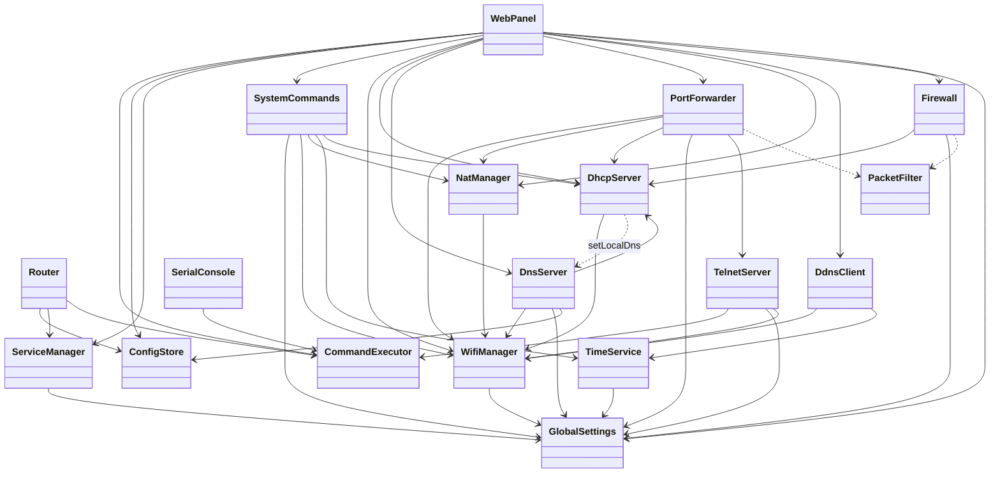

# Esp32Router – source code / kod źródłowy

[English](#english) | [Polski](#polski)

## English

Applies to version 0.2.0. For anyone who builds, uploads or extends the firmware. Design decisions and history up to 7.11.2026 (closed document, Polish, no further changes): [`dev/projekt.md`](dev/projekt.md).

### 1. Requirements

- **PlatformIO** (Visual Studio Code extension or `pio` on the command line) with the **pioarduino** platform (`platform-espressif32`, stable release) – downloaded automatically on the first build (URL in `platformio.ini`).
- Framework: plain **ESP-IDF 5.5** (no Arduino), C++.
- Python 3 (included in PlatformIO) – the scripts in `tools/` use only the standard library.
- An ESP32-S3 board with 8 MB flash (QIO) and octal PSRAM.

### 2. Entry point – `Router`

**`src/Router.h` / `src/Router.cpp` is the most important file of the project** – start reading the code here. `main.cpp` contains only:

```cpp
extern "C" void app_main(void)
{
    static Router router;   // constructor: all modules and dependencies
    router.start();         // start in a fixed order
}
```

- **The `Router()` constructor** creates all modules as class members (one instance of each, no allocation at run time) and passes them their dependencies through constructors (references). The order of members in `Router.h` is the creation order – a module may depend only on members declared above it.
- **`Router::start()`** – start-up order:
  1. log buffer (`LogBuffer`), NVS (for the Wi-Fi driver), `esp_netif`, event loop,
  2. `ConfigStore::mount()` – LittleFS; registration of the modules with configuration files (`config.add(…)`) and `loadAll()` – loading all files (no file = default values from `Defaults.h`),
  3. `global.activate()` – log level, language, ping from WAN; DNS block list, panel password, DHCP → DNS link, start of the firewall packet filter,
  4. registration of the commands of all modules in `CommandExecutor` (afterwards the command tree is only read) and of the services in `ServiceManager`,
  5. `nat.start()`, `portfwd.start()`, `time.start()` – registration for network events before Wi-Fi starts (so that getting an address is not missed),
  6. `wifi.start()` – AP and STA; `services.startAutostart()` – services with autostart (`global.json` `services`),
  7. reaction to an AP restart (AP network change): NAT again, restart of the `dhcp` and `dns` services,
  8. confirmation of a correct firmware start (OTA rollback – without the confirmation the bootloader returns to the previous version).
- A new module is added exactly here: a member in `Router.h`, dependencies in the constructor's initializer list, registration in `start()` (ch. 10).

#### Dependencies between objects (0.2.0)

Solid arrow – dependency through the constructor (a module gets a reference to the other one); dashed – a link set in `start()` or a registry.


Registries (filled in `Router::start()`):
- **`ConfigStore`** – modules with a configuration file (`IConfigurable`): `GlobalSettings`, `WifiManager`, `NatManager`, `DhcpServer`, `PortForwarder`, `Firewall`, `DnsServer`, `WebPanel`, `DdnsClient`, `TelnetServer`.
- **`ServiceManager`** – services (`IService`): `SerialConsole` (serial), `TelnetServer`, `DhcpServer`, `DnsServer`, `WebPanel` (web), `DdnsClient`, `Firewall`.
- **`CommandExecutor`** – commands of all modules; shared by `SerialConsole`, `TelnetServer` and the panel (`/api/cmd`).

Shared parts without an object in `Router`:
- **`PacketFilter`** – packet filter in the lwIP hook (called by the network stack for every packet); its data is set by `Firewall` (rules), `PortForwarder` (forward sources), `GlobalSettings` (ping from WAN), `WifiManager` (interfaces).
- **`LogBuffer`** – log buffer (`sys log`, live logs in the panel), installed at the beginning of `start()`.
- **`i18n`** – current language (`tr()`), set by `GlobalSettings`; used by all modules.

### 3. Directory structure

```
Esp32Router/
├── platformio.ini        environments esp32-s3-devkitc-1 (USB) and esp32-s3-ota (Wi-Fi)
├── partitions.csv        partition table
├── sdkconfig.defaults    ESP-IDF settings (lwIP: forwarding, NAPT, sockets, PSRAM…)
├── CMakeLists.txt        ESP-IDF project, firmware version (PROJECT_VER)
├── include/              shared headers
├── src/                  firmware code
├── web/                  web panel (HTML, CSS, JS, dictionary)
├── tools/                scripts
└── doc/                  documentation (dev/ – design documents)
```

#### `include/`

| File | Contents |
|---|---|
| `Defaults.h` | factory settings of all modules and ranges of numeric fields (ch. 5) |
| `Secrets.h.example` | template of `Secrets.h`: default AP name and password, panel password |
| `Secrets.h` | your own values (not in git, created by the user) |
| `Log.h` | `LOG_E/W/I/D` macros enabled per file (`LOG_TAG`, `LOG_ENABLED`) |
| `lwip_hooks.h` | lwIP `IP4_INPUT` hook (firewall, ping from WAN, forward sources) |

#### `src/`

| File | Contents |
|---|---|
| `main.cpp` | `app_main` – creates and starts `Router` |
| `Router` | creates the modules, injects dependencies, start-up order |
| `ConfigStore` | JSON files on LittleFS (`/lfs/config`), `config show/set/diff/revert`, `save`, backup, factory reset |
| `ConfigReader` | reading fields with type and range checks, the `IConfigurable` interface |
| `GlobalSettings` | `global.json`: name, language, logs, time, management, ping from WAN, service autostart |
| `TimeService` | time zone, SNTP |
| `WifiManager` | APSTA mode: STA with retries, AP, scan, `wifi` commands |
| `NatManager` | NAPT on the AP interface, `nat on/off` |
| `DhcpServer` | own DHCP server: pool, leases, reservations |
| `DnsServer` | DNS server: local names, cache, upstream DNS, domain blocking |
| `PortForwarder` | port forwarding (lwIP portmap) |
| `PacketFilter` | packet filter in the lwIP hook: firewall rules, ping from WAN, forward sources |
| `Firewall` | firewall rules, `firewall` service, `fw` commands |
| `DdnsClient` | dynamic DNS client (3 accounts, HTTPS) |
| `WebPanel` | HTTP server: panel files, JSON API, login, OTA, WebSocket with logs |
| `WebAssets.h` | declaration of the compiled panel files (`generated/WebAssets.cpp` is created by `web_embed.py`) |
| `CommandExecutor` | command interpreter (group tree, abbreviations, help) |
| `SerialConsole` | console on USB (native USB of the ESP32-S3) |
| `TelnetServer` | Telnet server with the console |
| `LineEditor` | line editing and history for COM and Telnet |
| `IOutput`, `StringOutput` | command output (console, Telnet session, text for `/api/cmd`) |
| `IService`, `ServiceManager` | services start/stop/restart, autostart, `service` |
| `SystemCommands` | `status`, `clients`, `sys ota`, `sys mem`, `reboot` |
| `LogBuffer` | buffer of recent logs in PSRAM (`sys log`, live logs in the panel) |
| `i18n/I18n` | language versions: `tr("pl", "en")`, current language, console in ASCII |
| `idf_component.yml` | `joltwallet/littlefs` dependency |
| `CMakeLists.txt` | list of sources, lwIP hook wiring |

#### `web/`

| File | Contents |
|---|---|
| `index.html`, `style.css`, `app.js` | panel skeleton: login, header, menu, forms, language |
| `pages/<name>.html` + `.js` | pages (content and logic), fetched on the first visit |
| `i18n/en.json` | English dictionary (key = Polish text) |

#### `tools/`

| File | Contents |
|---|---|
| `web_embed.py` | on build compresses `web/` with gzip into `src/generated/WebAssets.cpp`, watches the budget, checks panel translations |
| `ota_upload.py` | upload over Wi-Fi (used by the `esp32-s3-ota` environment) |
| `defaults_table.py` | default-value tables (English and Polish) in `configuration.md` from `Defaults.h` |
| `i18n_check.py` | check of the firmware texts in two languages |

### 4. Architecture

- **`Router`** creates all modules once, at start-up, and passes them their dependencies through the constructor (e.g. `DnsServer` gets `DhcpServer` for device names).
- **Configuration**: a module with its own file implements `IConfigurable` (`configName()`, `loadConfig(ConfigReader&)`, `saveConfig()`, optionally `applyLive()` for fields that apply immediately) and registers in `ConfigStore` (`config.add(module)`). `ConfigReader` applies the default values from `Defaults.h` when the file or a field is missing and on an invalid value.
- **Services**: a module that can be stopped and started implements `IService` (`name()`, `start()`, `stop()`, `isRunning()`, `describe()`) and registers in `ServiceManager` (`services.add(module)`); autostart from `global.json` `services.<name>`.
- **Commands**: a module registers its commands in `CommandExecutor` (`exec.addGroup`, `exec.add`) – the same for COM, Telnet and the panel terminal (`/api/cmd`).
- **Panel**: `WebPanel` serves the files from `web/` and the JSON API; settings changes use the same mechanism as `config set`, actions – console commands.

#### Comments in the code

- Comments in the code are **in English**. In `.h` headers the **Doxygen** format:
  - at the top of the file `/** @file Name.h @brief … */` – one sentence on what the file contains,
  - class: `/** @brief … */` – role, responsibility, collaborators, which task/thread it runs in,
  - method: `/// @brief …` or `/** @brief … @param … @return … */` – what it does, notes on threads, mutexes and side effects,
  - field: `///< …` on the same line (what it holds, units, byte order of addresses).
- In `.cpp`: an `@file` header, a short `//` comment above helper functions without a declaration in `.h` and at non-obvious places (lwIP hooks, tcpip thread, AP restart). No line-by-line comments on the obvious.
- `web/*.js`: `//` comments and short `/** … */` above functions (comments are shipped to the panel – they count towards the first-load budget); `tools/*.py`: docstrings.
- Polish remains in: texts for the user (`tr("pl", "en")`, panel), `LOG_x` logs and the Polish part of the documentation in `doc/`.

### 5. Secrets.h and Defaults.h

- `include/Secrets.h` (copy from `Secrets.h.example`) – only the values you do not want in the repository: `SECRET_AP_SSID`, `SECRET_AP_PASS`, `SECRET_WEB_PASS`. The file is in `.gitignore`.
- `include/Defaults.h` – all other factory settings and ranges. Every value can be changed before building without changing the code, in `platformio.ini`:

```ini
[env:esp32-s3-devkitc-1]
build_flags = -DDEFAULT_DHCP_LEASE_TIME=3600 -DDEFAULT_GLOBAL_LANGUAGE=\"en\" -DDEFAULT_GLOBAL_HOSTNAME=\"router\"
```

  Macro name: `DEFAULT_<MODULE>_<CONSTANT>` (list in `Defaults.h`). A value out of range or a language other than `pl`/`en` stops the build. Default values apply when there is no configuration file and after a factory reset.
- After changing `Defaults.h` run `python tools/defaults_table.py` (updates the tables in the documentation).

### 6. Building and uploading

| Task | Command |
|---|---|
| build | `pio run` |
| upload over USB | `pio run -t upload` |
| USB console/log monitor | `pio device monitor` (opening the port resets the ESP) |
| upload over Wi-Fi (OTA) | `pio run -e esp32-s3-ota -t upload` |
| OTA to another address | `pio run -e esp32-s3-ota -t upload --upload-port 192.168.4.1:80` |

- The first upload is always over USB (it also writes the partition table and the bootloader).
- **OTA**: the computer must be in the router's AP network (or `mgmt_from_sta = true`). The script takes the panel password from the `ESP32ROUTER_WEB_PASS` variable, then from `SECRET_WEB_PASS` in `Secrets.h` (works only until the password was changed in the panel), finally it asks in the terminal:

```bash
ESP32ROUTER_WEB_PASS='panel-password' pio run -e esp32-s3-ota -t upload
```

  The script shows progress, logs in again after the restart and checks the version. A version other than the uploaded one = the new firmware did not start and the bootloader returned to the previous one (rollback). After 5 wrong passwords the panel blocks login for 60 s.
- The `esp32-s3-ota` environment has its own build directory (`.pio/build/esp32-s3-ota`) and inherits the configuration from the main one.

### 7. Partitions (8 MB)

| Partition | Address | Size | Contents |
|---|---|---|---|
| `nvs` | 0x9000 | 24 KB | Wi-Fi driver data |
| `phy_init` | 0xF000 | 4 KB | radio calibration |
| `ota_0` | 0x10000 | 3 MB | firmware (slot 1) |
| `littlefs` | 0x310000 | 1 MB | configuration (`/lfs/config`) |
| `ota_1` | 0x410000 | 3 MB | firmware (slot 2) |
| `otadata` | 0x710000 | 8 KB | which slot boots |

An update writes the firmware to the other slot; the new firmware confirms a correct start after Wi-Fi and the services are running, otherwise the bootloader returns to the previous one. The configuration (LittleFS) stays.

### 8. Web panel at build time

- `tools/web_embed.py` on every `pio run` compresses the files from `web/` with gzip and generates `src/generated/WebAssets.cpp` (not in git). A change in `web/` = new build and upload.
- It prints the size of each file and the **first load** (skeleton + Status page) – budget 12 KB after gzip; it warns when exceeded. Other pages and the dictionary are fetched only when visited.
- It checks the `web/i18n/en.json` dictionary: missing translations, unused keys, mismatched `{0}`.

### 9. Texts in two languages

- **Firmware**: every text for the user as a pair `tr("po polsku", "in English")` (`#include "i18n/I18n.h"`). In printf formats both versions must have the same `%s`, `%d`… Command description: `{ "opis", "description" }` in `exec.add`. Console table columns with translated text: `i18n::pad(text, width)`.
- `python tools/i18n_check.py` – checks that the formats in the pairs match and looks for texts in `print`/`printf` without `tr()`; exit code 1 on errors.
- **Panel**: texts in HTML and JS are written in Polish. HTML translates itself (texts, `data-label`, `data-help`, `placeholder`…). In JS: `t('text')`, with values `t('Klienci: {0}', n)`; text translated later (a label in an array): `tn('text')`. Add the translation to `web/i18n/en.json` (key = Polish text) – `web_embed.py` prints what is missing.
- Logs (`LOG_x`) are not translated.

### 10. Extending

**New module with settings and a service**
1. A class in `src/` (`Name.h/.cpp`) implementing `IConfigurable` and/or `IService`.
2. Default values and ranges in `include/Defaults.h` (macro `DEFAULT_<MODULE>_…`, constant in `namespace defaults::<module>`, `static_assert` for the range); in the module `namespace dflt = defaults::<module>;`.
3. In `Router`: a member, `config.add(...)`, `services.add(...)`, `registerCommands(executor)`; autostart – a field in `GlobalSettings` (`services.<name>`) and in `Defaults.h`.
4. Texts through `tr()`; `python tools/i18n_check.py`, `python tools/defaults_table.py`.
5. Description in `configuration.md` and `console.md` (both languages).

**New panel page**
1. `web/pages/<id>.html` (content; settings form: `<form data-config="module">` with `<div data-field="field" data-label="…">`) and `web/pages/<id>.js` (`App.page('<id>', { init(root, status) { … } })`).
2. An entry in `MENU` in `web/app.js`: `['<id>', tn('Label')]`.
3. Data: a new route in `WebPanel` (route table before `"/*"`; `max_uri_handlers` limit – currently 33 of 48) or the existing `/api/config/<module>` and `/api/cmd`.
4. Translations in `web/i18n/en.json`; `pio run` checks what is missing and the budget.

---

## Polski

Dotyczy wersji 0.2.0. Dla osoby, która kompiluje, wgrywa albo rozbudowuje firmware. Decyzje projektowe i historia do 7.11.2026 (dokument zamknięty, bez dalszych zmian): [`dev/projekt.md`](dev/projekt.md).

### 1. Wymagania

- **PlatformIO** (rozszerzenie Visual Studio Code albo `pio` w wierszu poleceń) z platformą **pioarduino** (`platform-espressif32`, wydanie stable) – pobierana automatycznie przy pierwszej kompilacji (adres w `platformio.ini`).
- Framework: czysty **ESP-IDF 5.5** (bez Arduino), język C++.
- Python 3 (jest w PlatformIO) – skrypty w `tools/` używają tylko biblioteki standardowej.
- Płytka ESP32-S3 z 8 MB flash (QIO) i PSRAM octal.

### 2. Punkt startu – `Router`

**`src/Router.h` / `src/Router.cpp` to najważniejszy plik projektu** – od niego zaczyna się czytanie kodu. `main.cpp` zawiera tylko:

```cpp
extern "C" void app_main(void)
{
    static Router router;   // konstruktor: wszystkie moduły i zależności
    router.start();         // start w ustalonej kolejności
}
```

- **Konstruktor `Router()`** tworzy wszystkie moduły jako pola klasy (jeden egzemplarz każdego, bez alokacji w czasie pracy) i przekazuje im zależności przez konstruktory (referencje). Kolejność pól w `Router.h` jest kolejnością tworzenia – moduł może zależeć tylko od pól zadeklarowanych wyżej.
- **`Router::start()`** – kolejność startu:
  1. bufor logów (`LogBuffer`), NVS (dla sterownika Wi-Fi), `esp_netif`, pętla zdarzeń,
  2. `ConfigStore::mount()` – LittleFS; rejestracja modułów z plikami konfiguracji (`config.add(…)`) i `loadAll()` – wczytanie wszystkich plików (brak pliku = wartości domyślne z `Defaults.h`),
  3. `global.activate()` – poziom logów, język, ping z WAN; lista blokad DNS, hasło panelu, powiązanie DHCP → DNS, start filtra pakietów firewalla,
  4. rejestracja poleceń wszystkich modułów w `CommandExecutor` (potem drzewo poleceń jest tylko czytane) i usług w `ServiceManager`,
  5. `nat.start()`, `portfwd.start()`, `time.start()` – zapis na zdarzenia sieci przed startem Wi-Fi (żeby nie przegapić otrzymania adresu),
  6. `wifi.start()` – AP i STA; `services.startAutostart()` – usługi z autostartem (`global.json` `services`),
  7. reakcja na ponowny start AP (zmiana sieci AP): NAT od nowa, restart usług `dhcp` i `dns`,
  8. potwierdzenie poprawnego startu firmware (rollback OTA – bez potwierdzenia bootloader wróci do poprzedniej wersji).
- Nowy moduł dodaje się właśnie tutaj: pole w `Router.h`, zależności w liście inicjalizacyjnej konstruktora, rejestracja w `start()` (rozdz. 10).

#### Zależności między obiektami (0.2.0)

Strzałka ciągła – zależność przez konstruktor (moduł dostaje referencję do drugiego); przerywana – powiązanie ustawiane w `start()` albo rejestr.



Rejestry (wypełniane w `Router::start()`):
- **`ConfigStore`** – moduły z plikiem konfiguracji (`IConfigurable`): `GlobalSettings`, `WifiManager`, `NatManager`, `DhcpServer`, `PortForwarder`, `Firewall`, `DnsServer`, `WebPanel`, `DdnsClient`, `TelnetServer`.
- **`ServiceManager`** – usługi (`IService`): `SerialConsole` (serial), `TelnetServer`, `DhcpServer`, `DnsServer`, `WebPanel` (web), `DdnsClient`, `Firewall`.
- **`CommandExecutor`** – polecenia wszystkich modułów; wspólny dla `SerialConsole`, `TelnetServer` i panelu (`/api/cmd`).

Elementy wspólne bez obiektu w `Router`:
- **`PacketFilter`** – filtr pakietów w haku lwIP (wywoływany przez stos sieciowy dla każdego pakietu); dane ustawiają `Firewall` (reguły), `PortForwarder` (źródła przekierowań), `GlobalSettings` (ping z WAN), `WifiManager` (interfejsy).
- **`LogBuffer`** – bufor logów (`sys log`, logi na żywo w panelu), instalowany na początku `start()`.
- **`i18n`** – bieżący język (`tr()`), ustawiany przez `GlobalSettings`; używany przez wszystkie moduły.

### 3. Struktura katalogów

```
Esp32Router/
├── platformio.ini        środowiska esp32-s3-devkitc-1 (USB) i esp32-s3-ota (Wi-Fi)
├── partitions.csv        tablica partycji
├── sdkconfig.defaults    ustawienia ESP-IDF (lwIP: forwarding, NAPT, gniazda, PSRAM…)
├── CMakeLists.txt        projekt ESP-IDF, wersja firmware (PROJECT_VER)
├── include/              nagłówki wspólne
├── src/                  kod firmware
├── web/                  panel WWW (HTML, CSS, JS, słownik)
├── tools/                skrypty
└── doc/                  dokumentacja (dev/ – dokumenty projektowe)
```

#### `include/`

| Plik | Zawartość |
|---|---|
| `Defaults.h` | ustawienia fabryczne wszystkich modułów i zakresy pól liczbowych (rozdz. 5) |
| `Secrets.h.example` | wzór `Secrets.h`: domyślna nazwa i hasło AP, hasło panelu |
| `Secrets.h` | własne wartości (poza gitem, tworzy użytkownik) |
| `Log.h` | makra `LOG_E/W/I/D` włączane per plik (`LOG_TAG`, `LOG_ENABLED`) |
| `lwip_hooks.h` | hak lwIP `IP4_INPUT` (firewall, ping z WAN, źródła przekierowań) |

#### `src/`

| Plik | Zawartość |
|---|---|
| `main.cpp` | `app_main` – tworzy i uruchamia `Router` |
| `Router` | tworzy moduły, wstrzykuje zależności, kolejność startu |
| `ConfigStore` | pliki JSON na LittleFS (`/lfs/config`), `config show/set/diff/revert`, `save`, kopia, reset fabryczny |
| `ConfigReader` | odczyt pól z kontrolą typu i zakresu, interfejs `IConfigurable` |
| `GlobalSettings` | `global.json`: nazwa, język, logi, czas, zarządzanie, ping z WAN, autostart usług |
| `TimeService` | strefa czasowa, SNTP |
| `WifiManager` | tryb APSTA: STA z ponawianiem, AP, skanowanie, polecenia `wifi` |
| `NatManager` | NAPT na interfejsie AP, `nat on/off` |
| `DhcpServer` | własny serwer DHCP: pula, dzierżawy, rezerwacje |
| `DnsServer` | serwer DNS: nazwy lokalne, cache, DNS nadrzędny, blokowanie domen |
| `PortForwarder` | przekierowanie portów (lwIP portmap) |
| `PacketFilter` | filtr pakietów w haku lwIP: reguły zapory, ping z WAN, źródła przekierowań |
| `Firewall` | reguły zapory, usługa `firewall`, polecenia `fw` |
| `DdnsClient` | klient dynamicznego DNS (3 konta, HTTPS) |
| `WebPanel` | serwer HTTP: pliki panelu, API JSON, logowanie, OTA, WebSocket z logami |
| `WebAssets.h` | deklaracja wkompilowanych plików panelu (`generated/WebAssets.cpp` tworzy `web_embed.py`) |
| `CommandExecutor` | interpreter poleceń (drzewo grup, skróty, help) |
| `SerialConsole` | konsola na USB (natywne USB ESP32-S3) |
| `TelnetServer` | serwer Telnet z konsolą |
| `LineEditor` | edycja linii i historia dla COM i Telnetu |
| `IOutput`, `StringOutput` | wyjście poleceń (konsola, sesja Telnet, tekst dla `/api/cmd`) |
| `IService`, `ServiceManager` | usługi start/stop/restart, autostart, `service` |
| `SystemCommands` | `status`, `clients`, `sys ota`, `sys mem`, `reboot` |
| `LogBuffer` | bufor ostatnich logów w PSRAM (`sys log`, logi na żywo w panelu) |
| `i18n/I18n` | wersje językowe: `tr("pl", "en")`, bieżący język, konsola w ASCII |
| `idf_component.yml` | zależność `joltwallet/littlefs` |
| `CMakeLists.txt` | lista źródeł, podpięcie haka lwIP |

#### `web/`

| Plik | Zawartość |
|---|---|
| `index.html`, `style.css`, `app.js` | szkielet panelu: logowanie, nagłówek, menu, formularze, język |
| `pages/<nazwa>.html` + `.js` | podstrony (treść i logika), pobierane przy pierwszym wejściu |
| `i18n/en.json` | słownik angielski (klucz = tekst polski) |

#### `tools/`

| Plik | Zawartość |
|---|---|
| `web_embed.py` | przy kompilacji pakuje `web/` gzipem do `src/generated/WebAssets.cpp`, pilnuje budżetu, sprawdza tłumaczenia panelu |
| `ota_upload.py` | wgrywanie przez Wi-Fi (używany przez środowisko `esp32-s3-ota`) |
| `defaults_table.py` | tabele wartości domyślnych (angielska i polska) w `configuration.md` z `Defaults.h` |
| `i18n_check.py` | kontrola tekstów firmware w dwóch językach |

### 4. Architektura

- **`Router`** tworzy wszystkie moduły raz, przy starcie, i przekazuje im zależności przez konstruktor (np. `DnsServer` dostaje `DhcpServer` dla nazw urządzeń).
- **Konfiguracja**: moduł z własnym plikiem implementuje `IConfigurable` (`configName()`, `loadConfig(ConfigReader&)`, `saveConfig()`, opcjonalnie `applyLive()` dla pól działających od razu) i rejestruje się w `ConfigStore` (`config.add(modul)`). `ConfigReader` stosuje wartości domyślne z `Defaults.h` przy braku pliku albo pola i przy błędnej wartości.
- **Usługi**: moduł, który da się zatrzymać i uruchomić, implementuje `IService` (`name()`, `start()`, `stop()`, `isRunning()`, `describe()`) i rejestruje się w `ServiceManager` (`services.add(modul)`); autostart z `global.json` `services.<nazwa>`.
- **Polecenia**: moduł rejestruje polecenia w `CommandExecutor` (`exec.addGroup`, `exec.add`) – te same dla COM, Telnetu i terminala panelu (`/api/cmd`).
- **Panel**: `WebPanel` serwuje pliki z `web/` i API JSON; zmiany ustawień idą przez ten sam mechanizm co `config set`, akcje – przez polecenia konsoli.

#### Komentarze w kodzie

- Komentarze w kodzie są **po angielsku**. W nagłówkach `.h` format **Doxygen**:
  - na początku pliku `/** @file Nazwa.h @brief … */` – jedno zdanie, co zawiera plik,
  - klasa: `/** @brief … */` – rola, odpowiedzialność, z kim współpracuje, w którym zadaniu/wątku działa,
  - metoda: `/// @brief …` albo `/** @brief … @param … @return … */` – co robi, uwagi o wątkach, muteksach i efektach ubocznych,
  - pole: `///< …` w tej samej linii (co przechowuje, jednostki, kolejność bajtów adresów).
- W `.cpp`: nagłówek `@file`, krótki komentarz `//` nad funkcjami pomocniczymi bez deklaracji w `.h` i przy nieoczywistych fragmentach (haki lwIP, wątek tcpip, ponowny start AP). Bez komentowania oczywistości linia po linii.
- `web/*.js`: komentarze `//` i krótkie `/** … */` nad funkcjami (komentarze trafiają do panelu – liczą się do budżetu pierwszego wejścia); `tools/*.py`: docstringi.
- Po polsku zostają: teksty dla użytkownika (`tr("pl", "en")`, panel), logi `LOG_x` i polska część dokumentacji w `doc/`.

### 5. Secrets.h i Defaults.h

- `include/Secrets.h` (skopiuj z `Secrets.h.example`) – tylko wartości, których nie chcesz w repozytorium: `SECRET_AP_SSID`, `SECRET_AP_PASS`, `SECRET_WEB_PASS`. Plik jest w `.gitignore`.
- `include/Defaults.h` – wszystkie pozostałe ustawienia fabryczne i zakresy. Każdą wartość można zmienić przed kompilacją bez zmiany kodu, w `platformio.ini`:

```ini
[env:esp32-s3-devkitc-1]
build_flags = -DDEFAULT_DHCP_LEASE_TIME=3600 -DDEFAULT_GLOBAL_LANGUAGE=\"en\" -DDEFAULT_GLOBAL_HOSTNAME=\"router\"
```

  Nazwa makra: `DEFAULT_<MODUŁ>_<STAŁA>` (lista w `Defaults.h`). Wartość spoza zakresu albo język inny niż `pl`/`en` zatrzymuje kompilację. Wartości domyślne obowiązują przy braku pliku konfiguracji i po resecie fabrycznym.
- Po zmianie `Defaults.h` uruchom `python tools/defaults_table.py` (aktualizuje tabele w dokumentacji).

### 6. Kompilacja i wgrywanie

| Zadanie | Polecenie |
|---|---|
| kompilacja | `pio run` |
| wgranie przez USB | `pio run -t upload` |
| podgląd konsoli/logów USB | `pio device monitor` (otwarcie portu resetuje ESP) |
| wgranie przez Wi-Fi (OTA) | `pio run -e esp32-s3-ota -t upload` |
| OTA na inny adres | `pio run -e esp32-s3-ota -t upload --upload-port 192.168.4.1:80` |

- Pierwsze wgranie zawsze przez USB (zapisuje też tablicę partycji i bootloader).
- **OTA**: komputer musi być w sieci AP routera (albo `mgmt_from_sta = true`). Hasło panelu skrypt bierze ze zmiennej `ESP32ROUTER_WEB_PASS`, potem z `SECRET_WEB_PASS` w `Secrets.h` (działa tylko, dopóki hasło nie zostało zmienione w panelu), na końcu pyta w terminalu:

```bash
ESP32ROUTER_WEB_PASS='hasło-panelu' pio run -e esp32-s3-ota -t upload
```

  Skrypt pokazuje postęp, po restarcie loguje się ponownie i sprawdza wersję. Inna wersja niż wgrana = nowy firmware nie wystartował i bootloader wrócił do poprzedniego (rollback). Po 5 błędnych hasłach panel blokuje logowanie na 60 s.
- Środowisko `esp32-s3-ota` ma osobny katalog budowania (`.pio/build/esp32-s3-ota`), konfigurację dziedziczy po głównym.

### 7. Partycje (8 MB)

| Partycja | Adres | Rozmiar | Zawartość |
|---|---|---|---|
| `nvs` | 0x9000 | 24 KB | dane sterownika Wi-Fi |
| `phy_init` | 0xF000 | 4 KB | kalibracja radia |
| `ota_0` | 0x10000 | 3 MB | firmware (slot 1) |
| `littlefs` | 0x310000 | 1 MB | konfiguracja (`/lfs/config`) |
| `ota_1` | 0x410000 | 3 MB | firmware (slot 2) |
| `otadata` | 0x710000 | 8 KB | który slot startuje |

Aktualizacja zapisuje firmware do drugiego slotu; nowy firmware potwierdza poprawny start po uruchomieniu Wi-Fi i usług, inaczej bootloader wraca do poprzedniego. Konfiguracja (LittleFS) zostaje.

### 8. Panel WWW przy kompilacji

- `tools/web_embed.py` przy każdym `pio run` pakuje pliki z `web/` gzipem i generuje `src/generated/WebAssets.cpp` (poza gitem). Zmiana w `web/` = nowa kompilacja i wgranie.
- Wypisuje rozmiar każdego pliku i **pierwsze wejście** (szkielet + strona Stan) – budżet 12 KB po gzip; ostrzega po przekroczeniu. Podstrony i słownik są pobierane dopiero przy wejściu.
- Sprawdza słownik `web/i18n/en.json`: brakujące tłumaczenia, nieużywane klucze, niezgodne `{0}`.

### 9. Teksty w dwóch językach

- **Firmware**: każdy tekst dla użytkownika jako para `tr("po polsku", "in English")` (`#include "i18n/I18n.h"`). W formatach printf obie wersje muszą mieć te same `%s`, `%d`… Opis polecenia: `{ "opis", "description" }` w `exec.add`. Kolumny tabel w konsoli z tekstem przetłumaczonym: `i18n::pad(tekst, szerokość)`.
- `python tools/i18n_check.py` – sprawdza zgodność formatów w parach i szuka tekstów w `print`/`printf` bez `tr()`; kod wyjścia 1 przy błędach.
- **Panel**: teksty w HTML i JS piszemy po polsku. HTML tłumaczy się sam (teksty, `data-label`, `data-help`, `placeholder`…). W JS: `t('tekst')`, z wartościami `t('Klienci: {0}', n)`; tekst tłumaczony później (etykieta w tablicy): `tn('tekst')`. Tłumaczenie dopisz do `web/i18n/en.json` (klucz = tekst polski) – `web_embed.py` wypisze, czego brakuje.
- Logi (`LOG_x`) nie są tłumaczone.

### 10. Rozbudowa

**Nowy moduł z ustawieniami i usługą**
1. Klasa w `src/` (`Nazwa.h/.cpp`), implementuje `IConfigurable` i/lub `IService`.
2. Wartości domyślne i zakresy w `include/Defaults.h` (makro `DEFAULT_<MODUŁ>_…`, stała w `namespace defaults::<moduł>`, `static_assert` dla zakresu); w module `namespace dflt = defaults::<moduł>;`.
3. W `Router`: pole klasy, `config.add(...)`, `services.add(...)`, `registerCommands(executor)`; autostart – pole w `GlobalSettings` (`services.<nazwa>`) i w `Defaults.h`.
4. Teksty przez `tr()`; `python tools/i18n_check.py`, `python tools/defaults_table.py`.
5. Opis w `configuration.md` i `console.md` (w obu językach).

**Nowa podstrona panelu**
1. `web/pages/<id>.html` (treść; formularz ustawień: `<form data-config="moduł">` z `<div data-field="pole" data-label="…">`) i `web/pages/<id>.js` (`App.page('<id>', { init(root, status) { … } })`).
2. Wpis w `MENU` w `web/app.js`: `['<id>', tn('Etykieta')]`.
3. Dane: nowa trasa w `WebPanel` (tabela tras przed `"/*"`; limit `max_uri_handlers` – obecnie 33 z 48) albo istniejące `/api/config/<moduł>` i `/api/cmd`.
4. Tłumaczenia w `web/i18n/en.json`; `pio run` sprawdzi braki i budżet.
